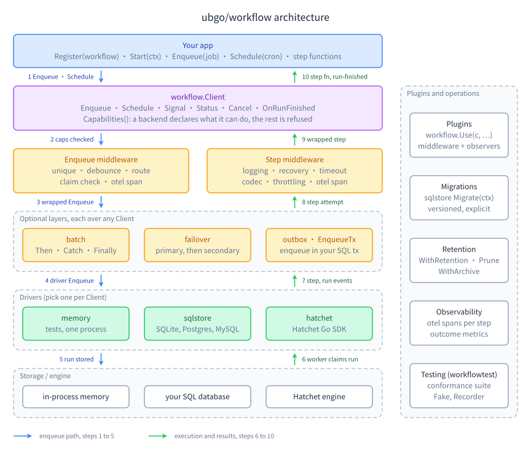

<h1 align="center">ubgo/workflow</h1>
<p align="center"><strong>Cron, delayed jobs, background queues and multi-step workflows for Go, behind one interface</strong></p>
<p align="center">One embeddable Go library for cron schedules, delayed jobs, background jobs with retries and multi-step workflows, behind one <code>Client</code> interface with swappable drivers.</p>

<p align="center">
  <a href="LICENSE"></a>
  
  
  
  
</p>

`ubgo/workflow` is an open-source Go job queue, cron scheduler and durable workflow library in one. The same handlers run on an in-memory driver in tests, on SQLite, Postgres or MySQL 8 through `database/sql` and [`ubgo/sqlb`](https://github.com/ubgo/sqlb), on Redis, or on the [Hatchet](https://github.com/hatchet-dev/hatchet) engine, and changing the backend is a constructor change rather than a rewrite. It covers cron with time zones, delayed and one-off jobs, retries with backoff, idempotency keys, concurrency keys and rate limits, durable sleeps and wait-for-event steps, batches with callbacks, unique and debounced jobs, transactional enqueue and a transactional outbox, failover between two backends, cron overlap control and trigger-now, failure alerts and Sentry reporting, an admin API and web UI, and OpenTelemetry tracing and metrics.

Status: early. The API is not stable and nothing is tagged yet; `sqlstore` uses the released `ubgo/sqlb` but resolves this repo's core module through a local `replace` until the core is tagged.

## Contents

- [Why ubgo/workflow?](#why-ubgoworkflow)
- [Documentation](#documentation)
- [Install](#install)
- [Packages](#packages)
- [Example](#example)
- [Development](#development)
- [FAQ](#faq)
- [Contributing](#contributing)
- [Security](#security)
- [License](#license)

## Why ubgo/workflow?

Every Go app that does work outside a request rebuilds the same stack: a cron runner, a job queue tied to one backend (Redis, Postgres only, or a cloud queue with hand-written polling), retries and uniqueness per app, and a workflow engine server for anything multi-step. Each choice locks the app into one backend, and code written against a workflow server cannot run without one. `ubgo/workflow` puts schedules, jobs and workflows behind one `Client` interface, so the backend becomes a deployment choice.

- **One interface, several drivers.** In-memory for tests and local runs, SQLite for a single binary, Postgres or MySQL 8 for many workers over one database, Hatchet when a managed engine is wanted.
- **Honest capabilities.** A driver declares what it can really do (`Caps`); `Register` (Hatchet) or `Start` (the other drivers) refuses a workflow that needs a capability the driver lacks, and a field the driver cannot honour returns an error wrapping `ErrUnsupported` that names it.
- **Proven, not claimed.** Every driver runs the shared `workflowtest` conformance suite against the real backend; the SQL driver adds multi-client tests (each step claimed once, one cron tick per schedule across three clients, a dead worker's lease reclaimed), and the Hatchet live suite kills a worker process mid-batch.
- **Your database, your transaction.** The SQL driver writes a run inside the app's own `*sql.Tx` (`EnqueueTx`), and the outbox does the same for any other driver.
- **Correct scheduling.** Its own cron parser, evaluated in an explicit time zone with written DST rules, and an injected clock, so tests advance time instead of sleeping.
- **A small core.** The core module imports only the standard library, enforced by `deps_test.go`; the SQL driver, Hatchet driver and OpenTelemetry middleware are separate modules.
- **Batteries as optional packages.** Batches with Then, Catch and Finally callbacks, unique and debounced jobs, claim check for big payloads, failover between backends, retention of finished runs, and test doubles with fluent assertions.

| | **ubgo/workflow** | Cron libraries | Single-backend job queues | Workflow engine servers |
|---|---|---|---|---|
| Cron in an explicit time zone | ✅ | ✅ | ⚠️ varies | ⚠️ varies |
| Durable background jobs with retries | ✅ | ❌ | ✅ | ✅ |
| Multi-step workflows, durable sleep, wait for event | ✅ | ❌ | ⚠️ varies | ✅ |
| Runs in-process with no extra server | ✅ memory, SQLite | ✅ | ⚠️ needs Redis or Postgres in most | ❌ |
| Same code on memory, SQLite, Postgres, MySQL and a hosted engine | ✅ | ❌ | ❌ | ❌ |
| Enqueue inside the app's own SQL transaction | ✅ SQL driver, outbox | ❌ | ⚠️ varies | ❌ |

If you want a single backend you already run and never expect to change, a dedicated queue for it exists; if you want the same job and workflow code to run in tests, on one SQLite file and on a cluster, that is `ubgo/workflow`.

## Documentation



- **[Learning path](docs/README.md#learning-path)**: fourteen steps from a first job on the memory driver to several workers on Postgres, each with its guide and a runnable example.
- **[Choosing](docs/choosing/README.md)**: decision tables for [which driver](docs/choosing/drivers.md), [which method](docs/choosing/methods.md) (`Enqueue`, `EnqueueTx` or the outbox; cron or `Schedule`; idempotency key, unique or debounce; and more), and [which setup for your kind of app](docs/choosing/app-types.md).
- **[Feature index](docs/reference/features.md)**: every feature with its package, guide section and example.
- **[Examples](examples/README.md)**: 86 runnable programs, each run by `go test`; every Go block in the guides is copied from one of them and checked by `task docs:snippets`.
- **[Benchmarks](docs/reference/benchmarks.md)**: enqueue throughput, end-to-end throughput and pickup latency for each driver, and how to reproduce them. On one laptop with 10 workers and a separate producer, sqlstore on Postgres picks up a new job in 7 ms median with LISTEN/NOTIFY against 415 ms when it only polls, and runs about 1,100 to 1,200 jobs/s end to end at 10 to 100 workers; the Redis driver picks up in under 1 ms and runs about 5,500 jobs/s end to end; Hatchet picks up in about 13 ms.
- **[All guides](docs/README.md#all-pages)**: jobs, schedules, workflows, drivers, middleware, observability, batches, reliability, testing, operations, admin and extending.

## Install

Nothing is tagged yet. The core module (which holds `clock`, `cron`, `memory`, `middleware`, `batch`, `failover` and `workflowtest`) has no `replace` and resolves as a pseudo-version from `main`:

```sh
go get github.com/ubgo/workflow@latest
```

The `hatchet`, `otel` and `sqlstore` modules resolve this repo's core through a local `replace` until the core is tagged, so build them from a clone of this repository (the committed `go.work` wires every module together).

## Packages

| Package | What it is |
|---|---|
| `github.com/ubgo/workflow` | The contract: `Client`, `Workflow`, `Step` (run, wait for event, sleep), `Job`, `Schedule`, retry and concurrency policies, capabilities (`Caps`), errors, `Define` for typed JSON handlers, `StepInfo` on the step context, the run-finished hook (`RunNotifier`, `RunEvent`), plugins (`Plugin`, `Use`: step middleware, enqueue middleware and run-finished observers bundled behind one name, each an optional interface). Retry jitter (`Backoff.Jitter`) and per-error delays (`RetryPolicy.DelayFor`, `RetryAfter`, `RetryAfterDelay`), resolved by one `RetryPolicy.NextDelay`; cron misfire policies (`Misfire{Policy, Within, Max}` with `MisfireSkip`, `MisfireFireOnce` or `MisfireFireAll` on `Workflow` and `Schedule`, applied by `Misfire.Due`; `MisfireGrace` 1m); `Workflow.CronLocation` (nil = UTC); capabilities `CapRetryJitter`, `CapRetryDelay`, `CapMisfireSkip`, `CapMisfireFireOnce`, `CapMisfireFireAll` and `CapCronZone`, checked by `Requires` and by `RequiresSchedule`/`CheckScheduleCaps`; `ErrUnavailable` with `Unavailable`/`IsUnavailable` for backend outages; the reserved label prefixes in one list (`ReservedLabelPrefixes`, `ReservedLabel`, `ValidateLabels`; `LabelPrefixInternal` `ubgo.workflow/`, `LabelPrefixBatch` `workflow.batch.`, `LabelPrefixOTel` `otel.`), refused on `Schedule.Labels`. Standard library only. Optional operator and scheduling contracts, each interface behind its own capability: named queues (`Workflow.Queue`, `Job.Queue`, `QueueConfig` with a per-client `Workers` cap and a cluster-wide `Limit`), per-job and bounded retries with one precedence rule (`Job.Retry` over `Step.Retry` over `Workflow.Retry` over `DefaultRetryMax`, resolved by `EffectiveRetriesFor`; `RetryPolicy.Until`, `MaxErrors`, `Discard`, and `DiscardOnExhaust` to end a run that ran out of retries discarded instead of failed), `RunQuerier` (with `RunQuery.Ref`), `RunRetrier`, `RunDeleter`, `BulkCanceller`, `Pauser`, `TickNotifier`, `ScheduleLister`, `SchedulePauser`, `Drainer` (with `DrainTimeout`, `ReportingDrainer` and `DrainReport` listing the attempts a drain cut off, and `ShutdownHook`, a plain `func(context.Context) error` for any phased shutdown manager), schedule conditions (`ScheduleWhen`, `Schedule.Windows`, `CronWindows`), `AttachScheduleHooks`, `RunInline`, and `Forward` for wrappers; the retrying and discarded run states (`StatusRetrying`, `StatusDiscarded`, `CapRunStates`) with the whole state machine as data (`Transitions`), chains of jobs edited from a running step (`Job.Chain`, `PrependToChain`, `AppendToChain`, `CapChain`), worker balancing (`WorkerScaler`, `Balancer`, `ByDepth`, `ByWait`, `BalanceLoop`, `CapWorkerScale`), in-process closures (`EnqueueClosure`, `CapClosure`), and deferred dispatch (`Deferred`, `DeferEnqueue`, `DeferHTTP`), which holds a request's enqueues until it succeeds. Durable closures by name (`NewFunc`, `Func`, `RegisterFunc`, `FuncJob`, `FuncStep`, `FuncQueue`/`FuncRetry`/`FuncTimeout`/`FuncCatch`: a one-step workflow, so every driver runs it); worker recycling (`Recycle`, `ErrRecycle`, `RecycleError`, `RecycleWatch`, `StopCauser`, `Serve`); label prefix search (`RunQuery.LabelPrefixes`, `CapLabelPrefix`, `CheckRunQuery`). Cron overlap policy (`OverlapSkip`), trigger-now (`ScheduleTriggerer`), last fire (`ScheduleInfo.Last`), per-attempt error history (`RunInfo.Errors`), force complete and fail (`RunForcer`), the `Reporter` interface for error trackers, and the capabilities behind them (`CapOverlapSkip`, `CapScheduleTrigger`, `CapScheduleHistory`, `CapEnqueueOnly`, `CapErrorHistory`, `CapShutdownRequeue`, `CapForceRun`, and the three added with the queue cap, discard-on-exhaust and drain report: `CapQueueLimitGlobal`, `CapDiscardExhausted`, `CapDrainReport`). Also, each behind its own capability: snooze (`Snooze`, `CapSnooze`), heartbeats (`Heartbeat`, `Step.HeartbeatTimeout`), tenants (`Job.Tenant`, `Schedule.Tenant`), run timeouts (`Workflow.RunTimeout`, `OnTimeout`, the `ErrTimeout` family), results (`ResultReader`, `Await`, `AwaitResult`), `ReportProgress`, `LifecycleNotifier`, node identity and `HealthChecker`, `RunRescheduler`, `StepCanceller`, due-time queries, FIFO per concurrency key, payload limits and versioning (`JobOf`, `DefineVersioned`, `Upcaster`), `AwaitChild` and `AwaitChildren`, `Memo` with `JournalStore`, `Choice`, `Loop`, `MapEach`, `Spawn`, run data, `UpstreamLimit` with `BucketStore`, `SecretGuard`, `PeriodKey` and `OncePerPeriod`, `ProcessChunks`, schedule specs as data (`Schedule` JSON, `cron.Calendar`, `NextRuns`, `Schedule.Seconds`, `Active`, `KeepRuns`, `InEnvironment`, `LocalCron`, `LabelTickAt`) and `Supports`, with the capabilities `CapSnooze`, `CapHeartbeat`, `CapTenant`, `CapRunTimeout`, `CapNodeIdentity`, `CapKeyFIFO`, `CapDueQuery`, `CapResult`, `CapCronSeconds`, `CapScheduleActive`, `CapScheduleKeep` and `CapTickTime`. |
| `clock` | The injected time source: `Real`, and `Fake` for tests (timers fire on `Advance`). |
| `cron` | Own five-field cron parser and next-run maths in an explicit time zone. `cron.Parser` (`Parse` is the default) for drivers that accept a custom dialect. `Builder` writes expressions from named frequencies (`cron.DailyAt("9:00").Weekdays()`, `EveryMinutes(15)`), wrapping `ErrBuilder`. Six-field expressions with seconds (`ParseSeconds`), structured calendar specs (`cron.Calendar`), `LoadZone` with zone validation; `cron/tzdata` embeds the time zone database (opt-in, about 450 KB). |
| `memory` | In-process driver: every capability except durability. For tests, local runs and work that may be lost on exit. `WithCronParser` (an opt-in custom dialect, which gives up the same-spec-on-every-driver promise) and `WithJitterSource`; the default misfire policy is fire-once. Implements every optional interface; `WithQueues` (with `Workers` and `Limit` caps), `WithStopWhenIdle`, `DrainWithReport`, and `WithRunRetention` (by default finished runs are kept 24 hours, at most 10,000). `WithRecycle` and `StopCause`; declares `CapLabelPrefix`. Overlap, trigger-now, last fire, error history (`WithErrorHistory`) and force; no enqueue-only mode or shutdown requeue, since its runs live in the process. |
| `middleware` | Step middleware (logging, recovery, timeout, codec, error throttling), enqueue middleware (unique, unique until the run finishes, debounce, route) and the `WithCodec` client wrapper that seals payloads, schedule inputs and Signal payloads; claim check for big payloads (`NewClaimCheck(store, threshold)` with `Enqueue`, `Step` and `CleanupOnFinish`: payloads and step outputs above the threshold go to a pluggable `BlobStore`, with `MemoryBlobStore` built in, and a reference travels in their place). Debounce and ThrottleErrors keep their state in pluggable stores (`DebounceStore` via `WithDebounceStore`, `CircuitStore` via `ThrottleConfig.Store`; in-process `MemoryDebounce`/`MemoryCircuit` by default), so a shared store makes them fleet-wide; `Logging` takes `WithLogLevel`; `Encrypt(key, oldKeys...)` decrypts with retired keys for rotation. `Release` puts a step back without running it (`ErrReleased`); `UniqueUntilStarted` and `ReleaseUniqueOnStart` free a unique lock when the run starts; `Pinger` sends heartbeat pings from schedule hooks; `WrapClient` and `WithCodec` forward every optional client interface. Task output: `CaptureOutput` with `OutputLogger` and an `OutputSink` (`WriterSink`, `FileSink` replace or append, `OutputSinkFunc` for a mailer), result only with `CaptureResult`. `UniqueByArgs` (unique by workflow and arguments); failure alerts with dedup and rate limits (`Alerts`, `AlertPlugin`, `AlertLimiter`); failure reporting (`Report`, `ReportFailures`, `ReportAttempts`). |
| `batch` | Batches of jobs with Then, Catch and Finally callbacks and progress, on any `Client`: run ends arrive through pluggable `Source`s (run-finished hook, `Client.Status` poller); a callback whose enqueue fails stays pending and is retried on the poller's tick, the next job end, or a retry loop Attach starts when no poller runs (`WithManualCallbackRetry` turns it off) under the batch's idempotency key; a client implementing `batch.GroupRunner` starts a batch's jobs as one native group; `Store` interface plus `MemoryStore`; a client implementing `batch.GroupSpawner` (Hatchet with `Config.BatchCoordinator`) starts the batch as one coordinator run whose children are tracked by label, which needs a `LabelSource`; a dispatch whose process died is resumed by `Manager.ResumeDispatches` (called by the poller, the retry loop and the Hatchet BatchSource) once its lease (`WithDispatchLease`) ends: it starts again only jobs known never to have started (a `RunFinder` on the client, or the per-job path's order) whose specs were kept (always on the group paths, `WithResumableDispatch` on the per-job path) and records the rest as cancelled. `Batch.Labels` are saved in State and copied onto Then, Catch and Finally jobs (reserved batch labels are refused); `WithIDFunc` for UUIDv7 or ULID batch IDs. `Manager.Add`, `RetryFailed` (`WithRetryableJobs`), `Before` and `Progress` callbacks, `Prune` through an optional `Pruner`, `AwaitStep`, `EnqueueMany`. |
| `failover` | A `workflow.Client` over a primary and a secondary backend (`failover.New(primary, secondary, opts...)`): Enqueue goes to the primary and, when an injectable `Classifier` calls its error "unavailable" (the default never fails over on a cancelled caller ctx, core sentinels such as `ErrInvalid`/`ErrUnsupported`/`ErrNotFound`/`ErrNotStarted`, or `Permanent` errors), to the secondary; a job without `IdempotencyKey` is refused with `ErrKeyRequired` (matches `ErrInvalid`) unless `AllowWithoutKey`, since an ambiguous primary failure can run it on both and a key dedups within one backend only; RunRefs, RunEvents and StepInfo carry a `primary:`/`secondary:` prefix in front of the driver's own ID so Status and Cancel reach the backend holding the run; Capabilities are the intersection (`CapCron` the primary's alone, since `Workflow.Cron` and `Schedule` live on the primary unless `WithSchedulesOnBoth`, to avoid double fires); Signal and OnRunFinished go to both (`CapRunFinished` only when both guarantee it); `WithCoolOff(n, d)` skips the primary for d after n consecutive failovers on an injected clock. `DefaultClassifier` also fails over on errors marked `workflow.Unavailable`, even when they wrap `context.DeadlineExceeded`; `StrictClassifier` fails over only on those; `WithObserver` reports failovers, primary skips and cool-off start and end. Implements the optional run and schedule interfaces: `Runs` merged across backends with prefixed refs, `Retry`/`Delete` by prefix, `CancelAll`/`Pause` on both, the schedule family the primary's unless `WithSchedulesOnBoth`. Passes `StopCause` through, joining both sides; `CapLabelPrefix` only when both backends have it. `TriggerSchedule` on the primary and `ForceComplete`/`ForceFail` by ref prefix; fired runs' `LabelSchedule` is the prefixed ID. |
| `workflowtest` | The conformance suite every driver runs (`workflowtest.Run`), plus app-test doubles: `Fake`, a recording client that runs nothing and refuses what a real driver refuses, with fluent assertions (`AssertEnqueued(t, wf, ...matchers)`, `AssertEnqueuedTimes`, `AssertNotEnqueued`, `AssertNothingEnqueued`, `AssertScheduled`, `AssertSignalled`, `AssertCancelled`); and `Recorder`, which wraps a real client and records its enqueues (its standalone mode, `NewRecorder(nil)`, is kept for compatibility; use `Fake` instead). `FakeCronParser`; the Fake enforces `CheckScheduleCaps`; conformance groups `retryseam` and `misfire`. `AssertBatched`/`AssertBatchCount`/`AssertNothingBatched`/`AssertChained`, `FakeExcept`/`FakeOnly` pass-through, `RunStep`; the Fake records `Retry`, `Delete` and `Pause` (`AssertRetried`, `AssertDeleted`, `AssertPaused`, `AssertEnqueuedOn`). Conformance groups `func`, `retryingerror`, `labelprefix` and `done`. The Fake records `TriggerSchedule`, `ForceComplete` and `ForceFail` (`AssertTriggered`, `AssertForced`); `Instance.EnqueueOnly`; conformance groups `overlap`, `trigger`, `schedhistory`, `enqueueonly`, `errorhistory`, `shutdownrequeue` and `force`. |
| `events` | Same module as the core: `events.Bus`, publish and subscribe inside the library (a published event becomes one `Enqueue` per matching subscription, deduplicated by event ID; not a message broker), `events.NewWebhook` (an inbound handler that verifies a signature and enqueues) and HMAC signing schemes (`events.HMAC`, `events.StandardWebhooks`). |
| `hybrid` | Same module as the core: `hybrid.New(scheduler, jobs)` fires crons on one client (usually memory) and keeps the runs on another (a durable driver), with an idempotency key per tick. |
| `github.com/ubgo/workflow/cli` | Separate module (standard library only): the `workflow` command over the admin JSON API (`runs`, `inspect`, `retry`, `cancel`, `pause`, `trigger`, `drain`, `metrics`, `health`, `nodes`, with `--json` and `--dry-run`), and `cli.Run` to embed it in your own binary. |
| `github.com/ubgo/workflow/hatchet` | Separate module (go 1.26): the Hatchet driver on the Hatchet Go SDK `sdks/go`; declares Durable, DelayedStart, WaitForEvent, DurableSleep, ConcurrencyKey, RateLimit, IdempotencyKey, Cron, Cancel, Queue, RunQuery, RetryRun, CancelAll, ScheduleList, Drain, DrainReport (PauseWorkflow and SchedulePause only with `Config.API`); refuses a non-zero `QueueConfig.Limit` and `RetryPolicy.DiscardOnExhaust`; implements RunNotifier best-effort (no CapRunFinished); quirks and refusals in `hatchet/doc.go`; implements `batch.GroupRunner` as bulk triggers (one RunMany per chunk of up to 1000 jobs of one workflow and about 2 MiB of input) and offers `Client.BatchSource(store, interval, logger)`, a batch completion source that makes one run-list call per open batch, filtered by its batch label, instead of one Status call per job; implements `batch.RunFinder` (`FindBatchRuns`, by label) for resumed dispatches; with `Config.BatchCoordinator` implements `batch.GroupSpawner`: one coordinator run per batch spawns the jobs as children keyed by index (a retried coordinator gets existing children back, proven by a SIGKILL test), `CancelGroup` cancels by label because the engine does not cascade a parent cancel to children, over about 2 MiB of input falls back to bulk triggers. `Config` tunings with today's defaults: `GroupChunkRuns`/`GroupChunkBytes` (bulk chunk of at most 1000 runs and 2 MiB, refused above), `BatchCoordinatorMaxInput`, `BatchCoordinatorRetry` (a `*workflow.RetryPolicy` on Hatchet's factor^n formula), `RegisterTimeout`, `VisibilityLag`; `Config.Logger` (nil discards) gets background errors (run-finished polls, observer panics, worker stop) and is BatchSource's default logger; `Config.Clock` drives poll tickers, the delivered-run window and the FinishedAt of a delayed start cancelled before it fired, while engine-compared times stay wall-clock; workflows are refused at Register; refuses a non-UTC `CronLocation`/`Schedule.Location`, any `Misfire` policy (Hatchet never catches up), `Backoff.Jitter` and `RetryPolicy.DelayFor`, and declares none of their capabilities; errors from an unreachable engine (gRPC Unavailable, network errors, HTTP 502/503/504) match `workflow.ErrUnavailable`. Named queues (`Config.Queues`: one Hatchet worker per queue), `Runs`, `Retry` (Hatchet replay), `CancelAll`, `Schedules`, `Drain`; a named `Schedule` upserts by name; `Config.API` adds workflow and schedule pause. Refuses run states, `Job.Chain`, worker scaling and closures (no `CapRunStates`, `CapChain`, `CapWorkerScale` or `CapClosure`): a run in backoff reads queued and a discarded run failed. `Config.Recycle` (worker recycling: workers paused on the engine, up to `Slots` attempts may start past `MaxJobs`) and `StopCause`; refuses `RunQuery.LabelPrefixes`; runs `Func`s with no driver change. `TriggerSchedule`, `ScheduleInfo.Last` read from the engine's run list (`Config.ScheduleHistoryWindow`) and `Config.EnqueueOnly`, each proven live; refuses `OverlapSkip`; no error history, shutdown requeue or force. Also: `CapTenant`, `CapTickTime`, `CapDueQuery`, `CapResult`, `CapCronSeconds` and `CapKeyFIFO` proven live, plus `Reschedule`, `Nodes`, `Health` and `Config.PayloadLimit`; refuses `Snooze`, heartbeats, run timeouts, `Active`, `KeepRuns` and queue weights, and keeps no per-attempt node history. |
| `github.com/ubgo/workflow/otel` | Separate module (go 1.25): OpenTelemetry step and enqueue middleware: a span per step attempt and per Enqueue, trace context carried from Enqueue to step in `otel.`-prefixed job labels, step duration and outcome metrics and an enqueue counter; job labels recorded as span attributes only on opt-in (`WithLabelFilter`, `WithAllLabels`); injected TracerProvider and MeterProvider. `WithParenting(ParentChild, ParentLink or ParentNewRootLink)` for span links instead of parent and child; `WithStepSpanName`/`WithEnqueueSpanName`; `WithMetricLabels(keys...)` for opt-in, named-only label dimensions on metrics; `Enqueue` refuses incoming `otel.`-prefixed labels. The `workflow.queue` attribute, the `workflow.queue.wait` histogram and the `workflow.queue.depth` gauge (`ObserveQueueDepth`). `RunFinished()` counts run ends on `workflow.runs.finished` by `workflow.run.status`; the step outcome `discarded`. Step spans carry `workflow.node`; `WithTenant()` records `workflow.tenant` on spans, never on metrics. |
| `github.com/ubgo/workflow/admin` | Separate module (go 1.24, standard library and the core only): operations over any driver (runs, failures, discarded runs, retry, delete, cancel, pause, schedules, queue stats with workers per queue on a scaling driver, each refused when the driver lacks it), a closed-by-default JSON API (`NewHandler` with typed `Identify` and `Authorize` hooks, JSON-only writes, payloads hidden unless `WithPayloads`) and a queue threshold `Monitor`. A web UI at `ui/` under the handler's mount (embedded, no third-party code, strict CSP, read-only `ActionUI`; Identify must accept the app's session cookie): queues, runs with filters and numbered pages, run detail, failures and discarded, schedules, pause and resume; `CountRuns` and `count=1`; schedule pause and resume routes (`PauseSchedule`, `ResumeSchedule`, `OpSchedulePause`); `label=key=prefix*`. Schedule inspect and Run now, force complete and fail, per-attempt errors (stacks with `WithStacks`) and captured output (`WithOutputs`, `OutputSourceFunc`, `MemoryOutputs`) in the API and the UI. Bulk retry and delete by filter with a dry run (`RetryAll`, `DeleteAll`), historical charts from a pluggable `MetricsSource` (`MemoryMetrics` by default), nodes, health, reschedule and cancel-step routes, and the Charts and System screens. |
| `github.com/ubgo/workflow/sqlstore` | Separate module (go 1.24): Durable SQL driver on `database/sql` through `ubgo/sqlb`. SQLite, Postgres and MySQL 8 are proven by the conformance suite, with every capability but `CapClosure` (a Go function cannot be stored), including `CapDurable` and `CapRunFinished`. Explicit, versioned `Migrate(ctx)` (numbered migrations on sqlb's `contrib/migrate` ledger, `<prefix>migrations` table, engine lock; refuses a newer schema with `ErrSchemaTooNew`); expiring leases; one row per cron tick; a step whose lease expires more than `WithMaxReclaims` times (default 5) fails its attempt with `ErrAbandoned`, then the retry policy applies; `Client.BatchStore()` is a durable `batch.Store`; opt-in retention of finished runs (`WithRetention`, `Prune`, `WithArchive`); `Client.EnqueueTx(ctx, tx, job)` writes a run inside the app's own `*sql.Tx` (commits or rolls back with the app's writes; idempotency keys under a savepoint so a duplicate never aborts the caller's tx; admitted after commit within the poll interval, or at once after `Client.Wake()`; enqueue middleware does not run); `UniqueStore` is a durable `middleware.UniqueStore` (ADR-0005) on `<prefix>unique_locks`. It has MemoryUnique's semantics exactly and is atomic across processes: an upsert on Postgres and SQLite; on MySQL, delete-expired then insert, decided by the primary key. Build it from a client (`Client.UniqueStore()`, created by `Client.Migrate`) or standalone with `NewUniqueStore(db, dialect, WithTablePrefix, WithClock)` plus `UniqueStore.Migrate`, so a Hatchet app with a database gets it without running the SQL driver. Expired locks are pruned by the dispatcher or by `PruneExpired`. Every capability includes retry jitter and `RetryAfter`, cron zones and all three misfire policies; `Schedule` with a Name upserts by (Workflow, Name); pluggable error classifier (`WithErrorClassifier`, `DefaultErrorClassifier`, `ErrorClass`; connection failures match `workflow.ErrUnavailable`), ID generator (`WithIDGenerator`, `IDKind`), Postgres schema (`WithSchema`), cron dialect (`WithCronParser`), jitter source (`WithJitterSource`) and tunings (`WithTxAttempts`, `WithTickRetention`, `WithHousekeepingEvery`, `WithPruneChunk`); `Retention.KeepLast`; `MigrationScripts` exports the frozen SQL for goose, Atlas or DBA pipelines (Start needs only the tables); migration `002_schedule_misfire`. `DebounceStore` is a durable `middleware.DebounceStore` on `<prefix>debounce` (`Client.DebounceStore` or standalone `NewDebounceStore`; its own migration list `ubgo/workflow/sqlstore/debounce`, `001_debounce`; Swap is atomic across processes; started bursts are pruned by the dispatcher or `PruneExpired`). Queues and operations: named queues (`WithQueues`, per-queue workers and priority), durable pauses shared by every client, `Runs`/`Retry`/`Delete`/`CancelAll`, schedule list, pause, windows and tick events, `Drain` and `WithStopWhenIdle`, `EnqueueMany` in one transaction and `BatchStore.Prune`; migration `003_queues_admin`; the retrying and discarded run states, `Job.Chain` stored with the run and edited from a running step, and `WorkerScaler` per process (migration `004_run_states_chain`). Label index (migration `005_run_labels`, `<prefix>run_labels`; `Client.IndexLabels` backfill, run by `Migrate`, needed once after `MigrationScripts`) behind `CapLabelPrefix` and `RunQuery.Labels`; `WithRecycle` and `StopCause`. Overlap, trigger-now and last fire, `WithEnqueueOnly`, `WithErrorHistory`, force, shutdown requeue proven by the suite (migration `006_schedule_history`); wake-ups between clients (`WithNotifier`, `pgnotify` on Postgres LISTEN/NOTIFY); `OutputStore` for captured output (`001_output`). Also: tenants, results, progress, snooze, heartbeats, run timeouts, node identity (`Nodes`, `Health`, `WithNodeID`, `WithSchedulerOnly`, `WithoutScheduler`), `Reschedule`, `CancelStep`, due-time queries, FIFO per key, queue weights, lifecycle events and `WithPayloadLimit` (migrations `007_leader_archive`, `008_run_info_nodes`, `009_schedule_tenant`); `WithLeaderElection`/`WithElector` for one cron fire node, `WithDatabaseClock`, `WithLeaseSkew` and `ErrLeaseLost` for nodes whose clocks disagree, `WithFetchBatch`, `WithArchiveTable` with `ArchivedRuns` (hot/cold tables), durable `JournalStore` and `BucketStore`, `Schedule.Tenant`. |
| `github.com/ubgo/workflow/sqlstore/outbox` | Same module as sqlstore: Transactional outbox for any `workflow.Client` (Hatchet, memory, a middleware-wrapped client): `Outbox.Write(ctx, tx, job)` inserts an entry inside the app's tx; a `Relay` (`NewRelay(target)`, `Start`/`Stop`/`Notify`/`Flush`) claims entries under a lease (SKIP LOCKED on Postgres/MySQL, conditional UPDATE on SQLite), enqueues each with the job's key or the entry ID as idempotency key, deletes it once accepted, and retries failures with backoff (`WithBackoff`, `WithMaxAttempts` → dead). At-least-once. Own migration list (owner `ubgo/workflow/sqlstore/outbox`, `001_outbox`) in the same `<prefix>migrations` ledger; explicit `Migrate`. `NewRelay` refuses a target without `CapIdempotencyKey` unless `AllowDuplicates`; dead entries reach `WithOnDead`, are read by `ListDead` (`DeadQuery`) and replayed by `Requeue`; `WithSchema`, `WithIDGenerator`, `MigrationScripts`. |
| `github.com/ubgo/workflow/sqlstore/pgnotify` | Same module as sqlstore: a `sqlstore.Notifier` on Postgres LISTEN/NOTIFY (`pgnotify.New(db)`), so an enqueue wakes idle workers on every machine at once; `Listen` needs the pgx stdlib driver (`ErrDriver` otherwise). |
| `github.com/ubgo/workflow/sqlstore/pgxtx` | Same module as sqlstore: `pgxtx.Run` hands `EnqueueTx` and `outbox.Write` a `*sql.Tx` that runs on the app's `pgx.Tx` (Postgres only). |
| `github.com/ubgo/workflow/redis` | Separate module (go 1.24): durable Redis driver on go-redis v9. Runs claimed whole under a renewed lease with fenced writes, reclaim after a crash, cron once across clients, idempotency keys, retries with jitter, misfire policies and zones, run list and delete, overlap, trigger-now, last fire, enqueue-only, error history, shutdown requeue and force, each proven by the conformance suite; Redis declares every capability but `CapClosure` and `CapQueueLimitGlobal`: wait steps and `Signal`, concurrency keys (with FIFO), rate limits, named queues with weights, pauses, chains, run-finished events, retry and bulk cancel, schedule conditions and tick events, tenants, results, progress, snooze, heartbeats, run timeouts, node identity, `Health`, scheduler-only and worker-only processes, worker scaling, and stores for the journal, the leaky bucket, debounce and uniqueness. |
| `github.com/ubgo/workflow/sentry` | Separate module (go 1.25): a `workflow.Reporter` on sentry-go, one event per failure with workflow, step and status tags, never the payload, labels only on opt-in. |
| `github.com/ubgo/workflow/bench` | Separate module (go 1.26), not a library: the benchmark harness ([benchmarks](docs/reference/benchmarks.md)). |

A driver declares what it can really do. `Register` (Hatchet) or `Start` (the other drivers) refuses a workflow that needs a capability the driver lacks, and a field the driver cannot honour returns an error wrapping `workflow.ErrUnsupported` that names it; nothing is silently dropped. The Hatchet driver's refusals are listed in `hatchet/doc.go`.

## Example

```go
type greet struct{ Name string }

c := memory.New()
err := c.Register(workflow.Workflow{
	Name: "greet",
	Steps: []workflow.Step{{
		Name: "say",
		Run: workflow.Define(func(ctx context.Context, in greet) (string, error) {
			return "hello " + in.Name, nil
		}),
	}},
})
// handle err

ctx, cancel := context.WithCancel(context.Background())
defer cancel() // cancelling the Start context stops the workers
if err := c.Start(ctx); err != nil {
	// handle err
}
ref, err := c.Enqueue(ctx, workflow.Job{Workflow: "greet", Payload: []byte(`{"Name":"Ada"}`)})
```

A runnable version is [examples/quickstart](examples/quickstart/) (and `Example` in `example_test.go`); the [Quickstart](docs/start/quickstart.md) walks through it.

## Development

Commands use [Task](https://taskfile.dev).

| Command | What it does |
|---|---|
| `task check` | The gate: gofmt, vet, race tests of every module (the examples module included), `gomin`, then the doc checks `docs:wrap`, `docs:links`, `docs:snippets`, `docs:words` and `docs:drift` |
| `task test` | Race tests of every module in `go.work` (the Hatchet live suite skips without a token) |
| `task gomin` | Vets each module under the Go version its `go.mod` declares (core, sqlstore, admin and redis 1.24, otel and sentry 1.25, hatchet, bench and examples 1.26) |
| `task examples:test` | Vet and test the examples module alone (every program under `examples/` and the doc checkers) |
| `task docs:wrap` | Fail on hard-wrapped prose in any tracked Markdown file |
| `task docs:links` | Fail when a relative link or `#anchor` in `README.md`, `docs/` or `examples/` does not resolve |
| `task docs:snippets` | Fail when a marked code block in the docs differs from its source region in an example; `task docs:snippets:sync` rewrites stale blocks |
| `task docs:words` | Fail when a forbidden word (the list lives in the task) appears in the Markdown under `docs/` and `examples/`, the top-level public Markdown files or any Go file git tracks |
| `task docs:drift` | docsync check (`ds` CLI) |
| `task hatchet:test:live` | The conformance suite plus the run-finished, batch, batch coordinator, crash and parity (queues, run query, retry, schedules, drain, pause, recycle), schedule trigger and history, enqueue-only and rate-limit scope live tests against a running Hatchet engine |
| `task redis:test` | Redis driver race tests against the shared stack's Redis (localhost:7012, each test under its own key prefix, deleted after); `WFTEST_REDIS_URL` points it at another Redis |
| `task bench` | The benchmarks, one system at a time, printing a results table; not part of `check` ([benchmarks](docs/reference/benchmarks.md)) |
| `task sqlstore:test:pg` | sqlstore race tests on SQLite and the host Postgres (database `ubgo_workflow_test`, each test in its own table prefix, dropped after) |
| `task sqlstore:test:mysql` | sqlstore race tests on SQLite and MySQL 8 (`sqlstore/compose.yml` throwaway profile on 127.0.0.1:33072, removed after the run, pass or fail) |

## FAQ

**Is ubgo/workflow ready for production?**

Not yet. The API is not stable and nothing is tagged. The drivers pass the conformance suite, but expect breaking changes until a first release.

**Does it need a server?**

No. The memory and SQLite drivers run inside your process; the Postgres and MySQL drivers need only the database, and the Redis driver only Redis. Hatchet is an optional driver for apps that already run a Hatchet engine.

**Can I switch backends later?**

Yes. `ubgo/workflow` is one interface over several backends, including MySQL, Redis and in-memory, and an app can move between them without rewriting its handlers.

**Will a cron job fire on every replica?**

Not on the SQL or Redis drivers: on SQL each cron tick is one row, and on Redis a compare-and-set moves the schedule's last tick, so a schedule declared on several clients fires once per tick, which tests run on three clients. On Hatchet the engine owns cron. To also skip a tick while the previous run is still going, set `Schedule.Overlap` to `workflow.OverlapSkip`. The memory driver is one process.

**Can I make a schedule fire on one chosen node?**

Yes, in two ways. On the SQL driver, `WithLeaderElection` (or `WithElector` with your own lock) limits cron firing to one elected node, and `WithSchedulerOnly` / `WithoutScheduler` split processes into schedulers and workers (Redis has the same two options). To fire crons in the process and run the jobs on a durable driver, put both behind `hybrid.New`. See [Nodes and health](docs/operations/nodes.md) and [Hybrid placement](docs/drivers/hybrid.md).

**What delivery guarantee does it give?**

At least once. A step whose worker dies is run again after its lease expires, so handlers should be idempotent; idempotency keys deduplicate enqueues within one backend.

**What happens when my backend does not support a feature?**

`Register` (Hatchet) or `Start` (the other drivers) refuses a workflow that needs a capability the driver lacks, and a field the driver cannot honour returns an error wrapping `workflow.ErrUnsupported` that names it. Nothing is silently dropped or emulated.

**Can I enqueue a job inside my database transaction?**

Yes. On the SQL driver, `Client.EnqueueTx(ctx, tx, job)` writes the run in your `*sql.Tx`, so it commits or rolls back with your writes. For any other driver, `sqlstore/outbox` writes an outbox entry in your transaction and a relay enqueues it after commit.

**Can I send a job only if the HTTP request that made it succeeds?**

Yes. Wrap your handler with `workflow.DeferHTTP` and enqueue through a client wrapped with `workflow.DeferEnqueue()`: the request's jobs are held and sent after the handler answers below 400, and dropped on an error status or a panic. It is not a transaction; when the job must follow a database commit, use `EnqueueTx` or the outbox. See [Deferred dispatch](docs/jobs/deferred.md).

**Do unique jobs and debounce work across several processes?**

Yes, with a shared store. `middleware.Unique` and `Debounce` keep their state in a `UniqueStore` and a `DebounceStore`, in-process by default; `sqlstore.UniqueStore` and `sqlstore.DebounceStore` make them hold across every process that shares the database, and work beside any driver, Hatchet included.

**Is there a dashboard?**

Yes. The `admin` module's handler serves a web UI (queues, runs with filters and pages, run detail, failures, schedules, pause and resume) beside its JSON API, behind your own login: it is closed until you give it `Identify` and `Authorize`, embeds its three files, and fetches nothing from the internet.

**Can I enqueue a plain Go function?**

Yes. `workflow.EnqueueClosure` runs a closure in process on the memory driver; for work that must survive a restart, register the function under a name with `workflow.NewFunc` and enqueue it with a JSON argument, which runs on every driver.

**Do workers on Postgres pick up new jobs at once?**

With `sqlstore.WithNotifier(pgnotify.New(db))`, yes: an enqueue sends a Postgres NOTIFY and idle workers on other machines start at once (measured p50 38 ms against 591 ms with a one-second poll). Polling stays as the fallback, so a lost notification only delays work.

**Can web servers enqueue without running workers?**

Yes. A client built with `sqlstore.WithEnqueueOnly()` (or the Redis driver's) enqueues and reads status without `Start`, and runs nothing; worker processes over the same database run the work.

**How do I get told when jobs fail?**

`middleware.AlertPlugin` calls your own sender (Slack, email, a pager) on final failures, deduplicated per workflow and step; `middleware.Report` hands failures to an error tracker, and the `sentry` module sends them to Sentry without the payload.

**How do I test code that enqueues jobs?**

Use `workflowtest.Fake`, a recording client that runs nothing, with assertions such as `AssertEnqueued` and `AssertScheduled`, or run the real handlers on the `memory` driver with the fake clock from `clock`.

## Contributing

`task check` is the gate; see [CONTRIBUTING.md](CONTRIBUTING.md) for the rules a change is reviewed against, and [CHANGELOG.md](CHANGELOG.md) for what is in `main`.

## Security

Report vulnerabilities privately; see [SECURITY.md](SECURITY.md).

## License

[Apache-2.0](LICENSE).
