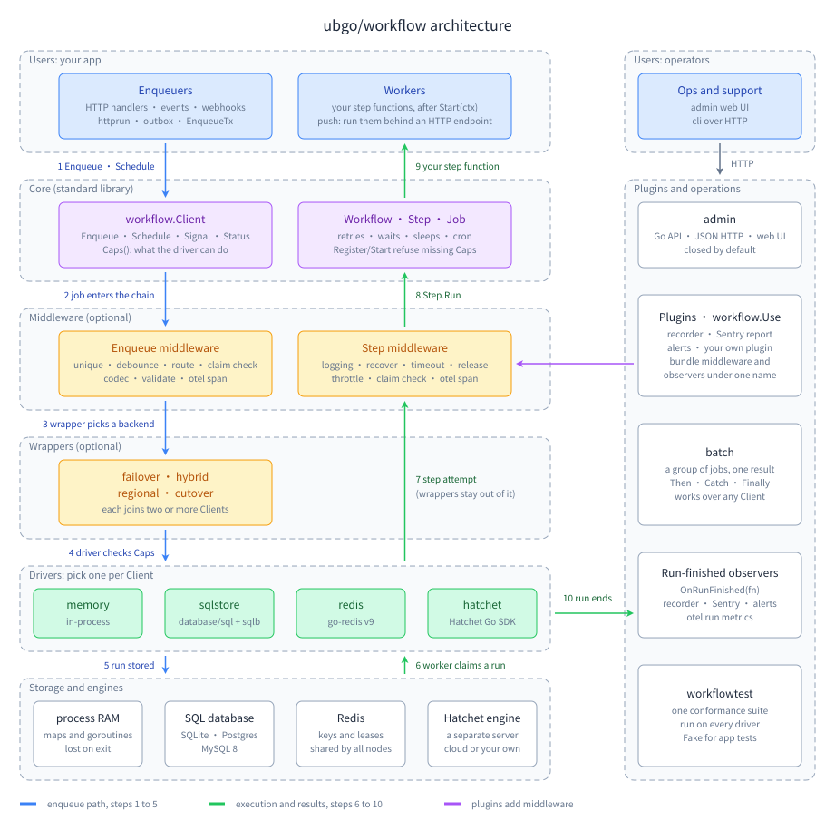

# ubgo/workflow documentation

Guides for `github.com/ubgo/workflow`: one Go API for background jobs, cron schedules and multi-step workflows, on an in-memory driver, a SQL driver (SQLite, Postgres, MySQL 8), a Redis driver or the Hatchet engine. Every guide is step by step, ends with its pitfalls, and copies its Go code from a runnable program under [examples/](../examples/), which `go test` runs, so the code on these pages compiles and works.

The diagram numbers the two paths: steps 1 to 5 are an enqueue, from your app through the capability check and enqueue middleware to the stored run; steps 6 to 10 are its execution, from a worker claiming the run through step middleware to your step function and the run-finished observers. Your app depends on `workflow.Client` alone. Plugins, middleware and failover wrap a client without hiding what it can do, and each driver declares its capabilities, so a feature a backend cannot honour is refused at start-up instead of silently dropped ([The client](concepts/client.md), [Capabilities](concepts/capabilities.md)).

## Contents

- [Learning path](#learning-path)
- [Start from your goal](#start-from-your-goal)
- [All pages](#all-pages): [Start](#start), [Choosing](#choosing), [Concepts](#concepts), [Jobs](#jobs), [Schedules](#schedules), [Workflows](#workflows), [Events](#events), [Drivers](#drivers), [Middleware](#middleware), [Observability](#observability), [Batches](#batches), [Reliability](#reliability), [Testing](#testing), [Operations](#operations), [Admin](#admin), [Extending](#extending), [Reference](#reference)

## Learning path

Thirteen steps from a first job to the full production setup. Read them in order; each builds on the one before, and each has a runnable program you can change and rerun. Skip a step your app does not need.

| # | Step | What you learn | Guide | Example |
|---|---|---|---|---|
| 1 | Run one job | Register a workflow, start the workers, enqueue a job, see its step run, on the in-memory driver | [Quickstart](start/quickstart.md), [Install](start/install.md) | [quickstart](../examples/quickstart/) |
| 2 | Write a real workflow | Steps that depend on each other, two in parallel, a join of their outputs, a retried step, a permanent failure and its `OnFailure` handler | [Your first workflow](start/first-workflow.md), [Workflows and steps](workflows/steps.md) | [first-workflow](../examples/first-workflow/) |
| 3 | Pick the right tools | Which driver, which method (job, workflow, schedule, batch, state machine, events) and which setup for your kind of app; how a driver refuses what it cannot do | [Choose a driver](choosing/drivers.md), [Choose a method](choosing/methods.md), [Choose by kind of app](choosing/app-types.md), [Capabilities](concepts/capabilities.md) | [capabilities](../examples/capabilities/) |
| 4 | Control how a job runs | Retries and backoff, `Retry-After` releases, delayed jobs, cancel and status, the four timeouts | [Retries](jobs/retries.md), [Errors](concepts/errors.md), [Run a job later](jobs/delays.md), [Cancel and status](jobs/cancel-and-status.md), [Timeouts](jobs/timeouts.md) | [retries](../examples/retries/), [release-errors](../examples/release-errors/), [delayed-jobs](../examples/delayed-jobs/) |
| 5 | Never do the same work twice | Idempotency keys, unique jobs, concurrency limits per key, rate limits, named queues | [Idempotency keys](jobs/idempotency.md), [Unique jobs](reliability/unique-jobs.md), [Concurrency and rate limits](jobs/concurrency.md), [Named queues](jobs/queues.md) | [idempotency](../examples/idempotency/), [unique-jobs](../examples/unique-jobs/), [concurrency](../examples/concurrency/), [named-queues](../examples/named-queues/) |
| 6 | Schedule recurring work | Cron on a workflow and at run time, time zones and DST, ticks missed during downtime, overlap, skipping stale runs | [Cron schedules](schedules/cron.md), [Time zones](schedules/time-zones.md), [Misfire policies](schedules/misfire.md), [Overlap](schedules/overlap.md), [Latest-only runs](schedules/latest-only.md) | [cron-schedules](../examples/cron-schedules/), [schedule-overlap](../examples/schedule-overlap/), [latest-only](../examples/latest-only/) |
| 7 | Wait for the outside world | Wait steps released by `Signal`, deadlines, durable sleeps, promises, signalling a run by its ID | [Wait for an event](workflows/signals.md), [Sleep inside a workflow](workflows/sleep.md), [Promises](workflows/promises.md), [Escalation](workflows/escalation.md) | [signals-and-sleep](../examples/signals-and-sleep/), [flow-promises](../examples/flow-promises/), [escalation](../examples/escalation/) |
| 8 | Build bigger flows | Child runs and joins, trigger rules and exit handlers, state machines, batches of jobs that report when all are done | [Child runs](workflows/children.md), [Joins](workflows/joins.md), [Trigger rules](workflows/trigger-rules.md), [State machines](workflows/state-machines.md), [Batches](batches/batches.md) | [flow-children](../examples/flow-children/), [flow-joins](../examples/flow-joins/), [state-machine](../examples/state-machine/), [batches](../examples/batches/) |
| 9 | Test your app | The Fake that refuses what production refuses, assertions, one step on its own, a fake clock | [Test app code with the Fake](testing/fake.md), [Test one step](testing/run-step.md), [Drive time in tests](testing/fake-clock.md) | [app-tests](../examples/app-tests/), [fake-forks](../examples/fake-forks/) |
| 10 | Make it durable | The SQL driver on SQLite, Postgres or MySQL, migrations your deploy runs, enqueue inside your own transaction, the outbox | [The SQL driver](drivers/sqlstore.md), [Migrations](operations/migrations.md), [Transactional enqueue](reliability/transactional-enqueue.md), [Outbox](reliability/outbox.md) | [sqlite-worker](../examples/sqlite-worker/), [migrations-export](../examples/migrations-export/), [transactional-enqueue](../examples/transactional-enqueue/), [outbox](../examples/outbox/) |
| 11 | See what runs | Step middleware, logs, traces and metrics, a run history you own, alerts on final failures | [Step middleware](middleware/step-middleware.md), [OpenTelemetry](observability/opentelemetry.md), [Record run history](observability/run-recorder.md), [Failure alerts](observability/failure-alerts.md) | [middleware-stack](../examples/middleware-stack/), [opentelemetry](../examples/opentelemetry/), [run-recorder](../examples/run-recorder/), [failure-alerts](../examples/failure-alerts/) |
| 12 | Operate it | Retry, reset, fork and cancel runs from Go, over HTTP, in a web UI or from a terminal; queue alerts | [Manage runs](jobs/manage-runs.md), [Admin operations](admin/operations.md), [Admin web UI](admin/ui.md), [The workflow command](admin/cli.md), [Queue alerts](admin/alerts.md) | [manage-runs](../examples/manage-runs/), [admin-ui](../examples/admin-ui/), [cli-tour](../examples/cli-tour/), [admin-alerts](../examples/admin-alerts/) |
| 13 | Go to production | Several workers on one database, one fire node, web nodes that only enqueue, clean shutdown, retention, health probes, failover; the launch checklist | [Going to production](start/production.md), [Deploy workers](operations/deploy.md), [Elect one fire node](drivers/sqlstore.md#elect-one-fire-node), [Retention](operations/retention.md), [Nodes and health](operations/nodes.md), [Failover](reliability/failover.md) | [postgres-cluster](../examples/postgres-cluster/), [sql-leader-election](../examples/sql-leader-election/), [graceful-drain-report](../examples/graceful-drain-report/), [retention](../examples/retention/), [failover](../examples/failover/) |

Past step 13, [Extending](#extending) shows how to write a plugin, middleware, a store or a driver of your own, and the [feature index](reference/features.md) lists every feature with its guide and example.

## Start from your goal

| I want to | Read | Example |
|---|---|---|
| Send an email after sign-up without blocking the request | [Enqueue a job](jobs/enqueue.md) | [quickstart](../examples/quickstart/) |
| Pick a backend for my app | [Choose a driver](choosing/drivers.md), [Choose by kind of app](choosing/app-types.md) | [capabilities](../examples/capabilities/) |
| Retry a flaky API call, honouring its `Retry-After` | [Retries](jobs/retries.md) | [retries](../examples/retries/) |
| Send a reminder tomorrow at 09:00, and cancel it if the user acts first | [Run a job later](jobs/delays.md), [Cancel and status](jobs/cancel-and-status.md) | [delayed-jobs](../examples/delayed-jobs/) |
| Run a nightly job, or a report per tenant in the tenant's zone | [Cron schedules](schedules/cron.md), [Time zones](schedules/time-zones.md) | [cron-schedules](../examples/cron-schedules/) |
| Accept a webhook twice and process it once | [Idempotency keys](jobs/idempotency.md) | [idempotency](../examples/idempotency/) |
| Keep one tenant from taking every worker | [Concurrency and rate limits](jobs/concurrency.md) | [concurrency](../examples/concurrency/), [fair-share](../examples/fair-share/) |
| Let one account see one run of several workflows at a time | [Concurrency › Share a limit between workflows](jobs/concurrency.md#share-a-limit-between-workflows) | [concurrency](../examples/concurrency/) |
| Pause a run until a payment or an approval arrives | [Wait for an event](workflows/signals.md) | [signals-and-sleep](../examples/signals-and-sleep/) |
| Save an order and enqueue its job atomically | [Transactional enqueue](reliability/transactional-enqueue.md), [Outbox](reliability/outbox.md) | [transactional-enqueue](../examples/transactional-enqueue/), [outbox](../examples/outbox/) |
| Allow one export per user at a time | [Unique jobs](reliability/unique-jobs.md) | [unique-jobs](../examples/unique-jobs/) |
| Reindex once after a burst of edits | [Coalescing runs](reliability/coalesce.md) | `Workflow.Coalesce`: one run kept pending beside the running one for a key, later enqueues folded into it | [coalesce](../examples/coalesce/) |
| [Debounce](reliability/debounce.md) | [debounce](../examples/debounce/) |
| Process 10,000 rows and know when all are done | [Batches](batches/batches.md) | [batches](../examples/batches/) |
| Send payloads too big for the queue | [Claim check](reliability/claim-check.md) | [claim-check](../examples/claim-check/) |
| Keep personal data out of the queue tables | [Payload codecs](middleware/codecs.md) | [encrypted-payloads](../examples/encrypted-payloads/) |
| Trace a job from the request that enqueued it | [OpenTelemetry](observability/opentelemetry.md) | [opentelemetry](../examples/opentelemetry/) |
| Keep my own runs table: who started each run, what each step did, after the engine pruned it | [Record run history](observability/run-recorder.md) | [run-recorder](../examples/run-recorder/) |
| Say who started each run, and refuse a job that does not | [Trigger source](concepts/trigger-source.md) | [trigger-source](../examples/trigger-source/) |
| Mark a run that succeeded but skipped work or rejected rows | [Run outcome](concepts/run-outcome.md), [Step events](concepts/step-events.md) | [step-events](../examples/step-events/) |
| Keep accepting jobs while the engine is down | [Failover](reliability/failover.md) | [failover](../examples/failover/) |
| Run several worker machines on one Postgres | [Deploy workers](operations/deploy.md) | [postgres-cluster](../examples/postgres-cluster/) |
| Run my jobs on the Redis I already have | [The Redis driver](drivers/redis.md) | [redis-worker](../examples/redis-worker/) |
| Run my jobs on Hatchet | [The Hatchet driver](drivers/hatchet.md) | [hatchet-worker](../examples/hatchet-worker/) |
| Test the code that enqueues, without running workers | [Test app code with the Fake](testing/fake.md) | [app-tests](../examples/app-tests/) |
| Send slow imports to their own workers and pause them during maintenance | [Named queues](jobs/queues.md) | [named-queues](../examples/named-queues/) |
| See failed runs, retry one from the failed step, or clear a backlog | [Manage runs](jobs/manage-runs.md), [Admin operations](admin/operations.md) | [manage-runs](../examples/manage-runs/), [admin](../examples/admin/) |
| Run a schedule only in office hours, and ping a heartbeat when it ends | [Schedule conditions](schedules/conditions.md), [Schedule hooks and pings](schedules/hooks.md) | [schedule-hooks](../examples/schedule-hooks/) |
| Send a confirmation email only if the request that ordered it succeeded | [Deferred dispatch](jobs/deferred.md) | [deferred-dispatch](../examples/deferred-dispatch/) |
| Tell a run waiting to retry from one waiting for a worker, and a dropped run from a failed one | [Run states](jobs/run-states.md) | [run-states](../examples/run-states/) |
| Let a job decide what runs after it | [Chains of jobs](workflows/chains.md) | [chain-edits](../examples/chain-edits/) |
| Give a backed-up queue the workers an idle one does not need | [Worker balancing](operations/balancing.md) | [worker-balancing](../examples/worker-balancing/) |
| Run a small Go function in the background without registering a workflow | [Closures](jobs/closures.md) | [closures](../examples/closures/) |
| Run a small Go function in the background so it survives a restart | [Functions by name](jobs/functions.md) | [functions](../examples/functions/) |
| Keep what a nightly task logged in a file, and mail it when the task fails | [Task output](schedules/output.md) | [task-output](../examples/task-output/) |
| Restart a worker after so many jobs, so long, or above a memory size | [Worker recycling](operations/recycling.md) | [worker-recycling](../examples/worker-recycling/) |
| Keep a slow hourly job from starting again while it still runs, and run it now by hand | [Idempotency keys on schedules](schedules/schedule-keys.md) | `Schedule.IdempotencyKey` and `OnHeld`: fired runs, triggers and hand enqueues of the same work deduplicated, a key per fire or per period | [schedule-keys](../examples/schedule-keys/) |
| [Overlap, trigger now and last fire](schedules/overlap.md) | [schedule-overlap](../examples/schedule-overlap/) |
| Be told once when runs keep failing, and send their errors to Sentry | [Failure alerts and error reporting](observability/failure-alerts.md) | [failure-alerts](../examples/failure-alerts/), [sentry-reporting](../examples/sentry-reporting/) |
| See every attempt's error, or end a stuck run by hand | [Manage runs › Error history](jobs/manage-runs.md#error-history), [Force a run to an end](jobs/manage-runs.md#force-a-run-to-an-end) | [run-repair](../examples/run-repair/) |
| Let web servers enqueue without running workers | [Deploy workers › Web nodes that only enqueue](operations/deploy.md#web-nodes-that-only-enqueue) | [enqueue-only](../examples/enqueue-only/) |
| Record runs enqueued on web nodes that run no workers | [Record run history › Web nodes that only enqueue](observability/run-recorder.md#web-nodes-that-only-enqueue), [The Hatchet driver › Record runs from web nodes](drivers/hatchet.md#record-runs-from-web-nodes) | [recorder-split](../examples/recorder-split/) |
| Start jobs at once on Postgres instead of at the next poll | [The SQL driver › Wake workers at once](drivers/sqlstore.md#wake-workers-at-once) | [worker-wakeup](../examples/worker-wakeup/) |
| Give operators a dashboard API with my own login | [Admin JSON API](admin/http-api.md) | [admin](../examples/admin/) |
| Give operators a web dashboard behind my own login | [Admin web UI](admin/ui.md) | [admin-ui](../examples/admin-ui/) |
| Find every run of one customer, or every order number starting with A- | [Search by label](jobs/manage-runs.md#search-by-label) | [label-search](../examples/label-search/) |
| Retry a step without charging the card twice | [Memoise work inside a step](workflows/memoisation.md) | [flow-memo](../examples/flow-memo/) |
| Accept a signed webhook and start a run once per delivery | [Inbound webhooks](events/webhooks.md) | [events-webhooks](../examples/events-webhooks/) |
| Stay inside an outside API's call limit per account | [Upstream rate limits](jobs/upstream-limits.md) | [upstream-limits](../examples/upstream-limits/) |
| Keep tokens and passwords out of stored payloads | [Secrets in payloads](reliability/secrets.md) | [secret-guard](../examples/secret-guard/) |
| Wait in a step until a third-party export is ready, without spending retries | [Retries › Snooze](jobs/retries.md#snooze-a-step-that-is-not-ready) | [snooze-heartbeat](../examples/snooze-heartbeat/) |
| Show a progress bar for a long export and hand back its result | [Progress and heartbeats](jobs/progress.md), [Results and awaiting a run](jobs/results.md) | [results-progress](../examples/results-progress/) |
| Change a job's payload shape without breaking queued jobs | [Typed payloads](jobs/payloads.md) | [typed-payloads](../examples/typed-payloads/) |
| Show a live progress bar and every retry as it happens | [Lifecycle events](observability/lifecycle.md) | [lifecycle-events](../examples/lifecycle-events/) |
| Give Kubernetes a liveness and a readiness probe | [Nodes and health](operations/nodes.md#health-and-readiness-probes) | [node-health](../examples/node-health/) |
| Fire crons in my process and keep the jobs in the database | [Hybrid placement](drivers/hybrid.md) | [hybrid-placement](../examples/hybrid-placement/) |
| Fire crons on one chosen node, or keep nodes with drifting clocks from stealing each other's steps | [The SQL driver › Clocks, skew and one fire node](drivers/sqlstore.md#clocks-skew-and-one-fire-node) | [sql-leader-election](../examples/sql-leader-election/), [postgres-cluster](../examples/postgres-cluster/) |
| Retry every failed run of a workflow from a terminal | [The workflow command](admin/cli.md) | [admin-cli](../examples/admin-cli/) |
| Run a schedule only in production, or only during a campaign week | [Schedule conditions](schedules/conditions.md) | [schedule-specs](../examples/schedule-specs/) |
| Warm a cache on every node every minute | [Local cron](schedules/local-cron.md) | [schedule-specs](../examples/schedule-specs/) |
| Share a counter or a cursor between runs of a workflow | [Memoise work inside a step › Share data across runs](workflows/memoisation.md#share-data-across-runs) | [scoped-data](../examples/scoped-data/) |
| Process a message delivered twice only once, even across a crash | [Idempotency keys › Drop redelivered messages with an inbox](jobs/idempotency.md#drop-redelivered-messages-with-an-inbox) | [consumer-inbox](../examples/consumer-inbox/) |
| Deploy a new version while old workers still run | [Deploy workers › Deploy a new version while old workers run](operations/deploy.md#deploy-a-new-version-while-old-workers-run) | [rolling-deploy](../examples/rolling-deploy/) |
| Keep each customer's jobs in their own region | [Regional routing](operations/regional-routing.md) | [regional-routing](../examples/regional-routing/) |
| Show customers a dashboard of their own tenant's runs | [Per-tenant dashboard](admin/tenants.md) | [admin-tenants](../examples/admin-tenants/) |
| Wait for the first of several mirrors, or two of four, and cancel the rest | [Joins and distributed maps](workflows/joins.md) | [flow-joins](../examples/flow-joins/) |
| Ask a human to approve a step with a signed link | [Polling, sleeping until, and approvals](workflows/polling-and-approval.md#human-approval) | [flow-patterns](../examples/flow-patterns/) |
| Start a job from an HTTP call and stream its progress to the browser | [Start a run over HTTP and follow it live](jobs/http-start.md) | [http-status](../examples/http-status/) |
| Turn many small notifications into one digest mail | [Aggregation and chunked fan-out](reliability/aggregate.md) | [aggregate-digest](../examples/aggregate-digest/) |
| Change a scheduled job before it runs | [Edit a scheduled run](jobs/edit-runs.md) | [edit-run](../examples/edit-run/) |
| Let a child run tell its parent something without stopping, or react to signals while a run goes on | [Escalation and signal handlers](workflows/escalation.md) | [escalation](../examples/escalation/) |
| Move an order through its states, refuse events that are not valid in its current state, and cancel it if it is not paid within 30 minutes | [State machines](workflows/state-machines.md) | [state-machine](../examples/state-machine/) |
| Write a process that waits for days as one function with local variables | [Deterministic replay](workflows/replay.md) | [flow-replay](../examples/flow-replay/) |
| Change a workflow's steps, waits or retries without a new build | [Definitions as data](workflows/definitions-as-data.md) | [workflow-json](../examples/workflow-json/) |
| Let services react to each other's events, compensations included, and still see one order's whole saga | [Choreography and saga choreography](events/choreography.md#list-a-chain) | [saga-choreography](../examples/saga-choreography/) |
| Re-run a run that succeeded from one step, or fork it into a new run | [Manage runs › Reset a run that succeeded](jobs/manage-runs.md#reset-a-run-that-succeeded) | [reset-fork](../examples/reset-fork/) |
| Choose between a job, a workflow, a schedule, a batch, a state machine and events | [Choose a method](choosing/methods.md) | [first-workflow](../examples/first-workflow/) |
| Keep the runs table small and still read last year's runs | [The SQL driver › Keep the hot tables small](drivers/sqlstore.md#keep-the-hot-tables-small) | [sql-archive](../examples/sql-archive/) |
| Hold the workers until the device clock is right | [Start when ready](operations/start-gate.md) | [start-gate](../examples/start-gate/) |
| Fire a reminder on time on a laptop that went to sleep | [Laptops that sleep](operations/sleep-and-wake.md) | [sleep-wake](../examples/sleep-wake/) |
| Run staging and production on one database without seeing each other's runs | [Namespaces](operations/namespaces.md) | [namespaces](../examples/namespaces/) |
| Skip the work of stale scheduled runs after downtime | [Latest-only runs](schedules/latest-only.md) | [latest-only](../examples/latest-only/) |
| Let a heavy render step take several worker slots | [Heavy steps and worker slots](jobs/slots.md) | [step-slots](../examples/step-slots/) |
| Run one step on GPU machines | [Named queues › Run one step on an accelerator](jobs/queues.md#run-one-step-on-an-accelerator) | [accelerator-queue](../examples/accelerator-queue/) |
| Turn a panic into a failed attempt, cap a step's time, fail at once on a declined card | [Step middleware](middleware/step-middleware.md) | [step-middleware](../examples/step-middleware/) |
| Send bulk jobs to a workflow of their own, or label every job by default | [Enqueue middleware › Route jobs](middleware/enqueue-middleware.md#route-jobs) | [route-jobs](../examples/route-jobs/) |
| Back off on a 429 without counting it as a failure | [Errors › Tell a release from a failure](concepts/errors.md#tell-a-release-from-a-failure) | [release-errors](../examples/release-errors/) |
| Be told when a queue backs up or waits too long | [Queue alerts](admin/alerts.md) | [admin-alerts](../examples/admin-alerts/) |
| Script run operations from CI, with exit codes | [The workflow command](admin/cli.md) | [cli-tour](../examples/cli-tour/) |
| Keep the run history in my own SQL database | [Record run history › The SQL store](observability/run-recorder.md#the-sql-store) | [recorder-sql](../examples/recorder-sql/) |
| Enqueue a run from Python, PHP or a database trigger | [Enqueue from other languages](drivers/sqlstore-insert-contract.md) | [insert-contract](../examples/insert-contract/) |
| Remind someone about a slow step without stopping it | [Trigger rules › A timer that does not stop the step](workflows/trigger-rules.md#a-timer-that-does-not-stop-the-step) | [flow-boundary](../examples/flow-boundary/) |
| Cancel every child run a step started | [Joins › Cancel every child of a step](workflows/joins.md#cancel-every-child-of-a-step) | [flow-cancel](../examples/flow-cancel/) |
| Define a state machine in JSON and change it without a build | [Definitions as data › State machines as data](workflows/definitions-as-data.md#state-machines-as-data) | [machine-dsl](../examples/machine-dsl/) |
| Test code that resets, forks or signals runs, without workers | [Test app code with the Fake › Forks and batches](testing/fake.md#forks-and-batches) | [fake-forks](../examples/fake-forks/) |
| Run my driver's conformance suite in parallel CI jobs | [Write a driver › Run the suite in shares](extending/writing-a-driver.md#run-the-suite-in-shares) | [driver-conformance](../examples/driver-conformance/) |
| Know when traffic failed over to the second backend | [Failover](reliability/failover.md) | [failover-observer](../examples/failover-observer/) |
| Check whether the library has a feature | [Feature index](reference/features.md) | |

## All pages

### Start

| Page | What it covers | Examples |
|---|---|---|
| [Install](start/install.md) | The core module, the separate modules (`sqlstore`, `redis`, `hatchet`, `otel`, `sentry`, `admin`, `cli`) and the Go version each needs | [quickstart](../examples/quickstart/) |
| [Quickstart](start/quickstart.md) | One workflow on the memory driver in about thirty lines, then the same code on SQLite | [quickstart](../examples/quickstart/), [sqlite-worker](../examples/sqlite-worker/) |
| [Your first workflow](start/first-workflow.md) | Four steps with a retry, a parallel pair, a join and a failure handler | [first-workflow](../examples/first-workflow/) |
| [Going to production](start/production.md) | The checklist: durable driver, migrations, idempotent handlers, clean shutdown, retention, logs | [postgres-cluster](../examples/postgres-cluster/) |

### Choosing

| Page | What it covers | Examples |
|---|---|---|
| [Choosing](choosing/README.md) | The decision guides, what each one decides, and quick answers to the first decisions | — |
| [Choose a driver](choosing/drivers.md) | Memory, SQL, Redis or Hatchet: durability, machines, what you operate, each driver's capabilities and refusals; the hybrid, failover, regional, cutover and pool wrappers | [quickstart](../examples/quickstart/), [sqlite-worker](../examples/sqlite-worker/), [postgres-cluster](../examples/postgres-cluster/), [redis-worker](../examples/redis-worker/) |
| [Choose a method](choosing/methods.md) | `Enqueue`, `EnqueueTx` or the outbox; cron or `Schedule`; batches; duplicate guards; limits; delays; retry, snooze or release; failing at once; run-end hooks | [retries](../examples/retries/), [cron-schedules](../examples/cron-schedules/), [first-workflow](../examples/first-workflow/), [quickstart](../examples/quickstart/) |
| [Choose by kind of app](choosing/app-types.md) | A starting setup per kind of app (one binary, a web fleet with workers, several tenants or regions, an edge device, a backend move) and which test tool for which test | [app-tests](../examples/app-tests/), [sqlite-worker](../examples/sqlite-worker/), [batch-tests](../examples/batch-tests/), [enqueue-only](../examples/enqueue-only/) |
| [Choose the shape of the work](choosing/shapes.md) | A job, a closure, a workflow, a chain, child runs, a batch, `RunInline`, a schedule, a virtual object, a state machine, a saga, events or choreography | [quickstart](../examples/quickstart/), [functions](../examples/functions/), [closures](../examples/closures/), [first-workflow](../examples/first-workflow/) |
| [Choose how a run waits](choosing/waiting.md) | Sleep, `SleepUntil`, `RunAt` or snooze; a wait step and `Signal`, `SignalRun`, `OnSignals`, `SignalWaiting`, an approval, `Poll`, promises, `Update`, `SignalWithStart` | [flow-patterns](../examples/flow-patterns/), [flow-promises](../examples/flow-promises/), [signals-and-sleep](../examples/signals-and-sleep/), [escalation](../examples/escalation/) |
| [Choose a schedule tool](choosing/schedules.md) | `Workflow.Cron`, `Schedule`, local cron, hybrid or `RunAt`; who fires a tick (the tick row, leader election or a scheduler node); missed and stale ticks (misfire policies, `LatestOnly` or overlap) | [cron-schedules](../examples/cron-schedules/), [sql-leader-election](../examples/sql-leader-election/), [latest-only](../examples/latest-only/), [schedule-specs](../examples/schedule-specs/) |
| [Choose an operations tool](choosing/operations.md) | Archive tables, the `WithArchive` hook or the run recorder's archive; `StartWhen` or a readiness probe, with the database clock and `WakeChecked` | [retention](../examples/retention/), [recorder-sql](../examples/recorder-sql/), [start-gate](../examples/start-gate/), [sql-archive](../examples/sql-archive/) |

### Concepts

| Page | What it covers | Examples |
|---|---|---|
| [The client](concepts/client.md) | The one `Client` interface, start and stop, validation | [graceful-drain](../examples/graceful-drain/), [capabilities](../examples/capabilities/), [client-wrapper](../examples/client-wrapper/), [first-workflow](../examples/first-workflow/) |
| [Capabilities](concepts/capabilities.md) | What a driver declares, checking workflows and schedules, refusals | [capabilities](../examples/capabilities/) |
| [Errors](concepts/errors.md) | Sentinel errors, the backend-outage marker, a release told apart from a failure | [release-errors](../examples/release-errors/), [capabilities](../examples/capabilities/), [lifecycle-events](../examples/lifecycle-events/) |
| [Labels](concepts/labels.md) | Job labels, the reserved prefixes, and the packages allowed to write them | [capabilities](../examples/capabilities/), [trigger-source](../examples/trigger-source/) |
| [Trigger source](concepts/trigger-source.md) | What started a run: `WithSource`, the sources `SourceOf` derives, `RequireSource` | [trigger-source](../examples/trigger-source/) |
| [Step events](concepts/step-events.md) | A step's timeline: `RecordEvent`, event sinks, bounds, the recorder and `CaptureOutput` | [step-events](../examples/step-events/) |
| [Run outcome](concepts/run-outcome.md) | Whether the work succeeded, apart from the status: `SetOutcome`, the default outcome | [step-events](../examples/step-events/) |
| [Plugins](concepts/plugins.md) | Adding a feature to a client with `workflow.Use` | [custom-plugin](../examples/custom-plugin/) |
| [Time](concepts/time.md) | The injected clock every scheduling decision reads | [custom-driver](../examples/custom-driver/) |

### Jobs

| Page | What it covers | Examples |
|---|---|---|
| [Enqueue a job](jobs/enqueue.md) | `Job`, `RunRef`, payloads, labels and priority | [quickstart](../examples/quickstart/), [concurrency](../examples/concurrency/) |
| [Run a job later](jobs/delays.md) | `Job.RunAt` and scheduled runs | [delayed-jobs](../examples/delayed-jobs/) |
| [Idempotency keys](jobs/idempotency.md) | One run per key, and requiring or ignoring keys per workflow | [idempotency](../examples/idempotency/), [consumer-inbox](../examples/consumer-inbox/), [upstream-limits](../examples/upstream-limits/) |
| [Retries](jobs/retries.md) | Retry policies, per-step retries, backoff and jitter, `Retry-After`, permanent errors, snooze | [retries](../examples/retries/), [retry-limits](../examples/retry-limits/), [discard-exhausted](../examples/discard-exhausted/), [snooze-heartbeat](../examples/snooze-heartbeat/) |
| [Concurrency and rate limits](jobs/concurrency.md) | Limits per key, strategies for the run over the limit, FIFO per key, several keys per workflow, one limit shared by several workflows, fair turns and weights between keys, rate limits | [concurrency](../examples/concurrency/), [fair-share](../examples/fair-share/), [queue-weights](../examples/queue-weights/) |
| [Cancel and status](jobs/cancel-and-status.md) | Stopping a run and reading where it is | [delayed-jobs](../examples/delayed-jobs/) |
| [Named queues](jobs/queues.md) | `Workflow.Queue` and `Job.Queue`, workers, priority and weights per queue, pausing a queue | [named-queues](../examples/named-queues/), [accelerator-queue](../examples/accelerator-queue/), [queue-limit](../examples/queue-limit/), [queue-weights](../examples/queue-weights/) |
| [Manage runs](jobs/manage-runs.md) | List, search by label, retry, delete and bulk-cancel runs; due-time filters, reschedule, cancel one step; pause a workflow, a queue or everything | [manage-runs](../examples/manage-runs/), [run-reschedule](../examples/run-reschedule/), [run-control](../examples/run-control/), [run-repair](../examples/run-repair/) |
| [Run a workflow inline](jobs/run-inline.md) | `RunInline`: one run in the caller's goroutine, with no client or workers | [run-inline](../examples/run-inline/) |
| [Run states](jobs/run-states.md) | The retrying and discarded statuses, next-attempt time, querying them, batches and discarded jobs, switching on statuses, the run state machine as data | [run-states](../examples/run-states/), [run-transitions](../examples/run-transitions/), [discard-exhausted](../examples/discard-exhausted/) |
| [Deferred dispatch](jobs/deferred.md) | Jobs enqueued during a request, sent only when it succeeds: `DeferHTTP`, `Deferred` by hand, and when a transaction is better | [deferred-dispatch](../examples/deferred-dispatch/) |
| [Closures](jobs/closures.md) | A Go function run as an in-process job on the memory driver, and why durable drivers refuse it | [closures](../examples/closures/) |
| [Functions by name](jobs/functions.md) | A Go function registered under a name and enqueued with a JSON argument: durable closures on every driver | [functions](../examples/functions/) |
| [Heavy steps and worker slots](jobs/slots.md) | `Step.Slots`, `CapSlotCost` and the `SlotPool` rule | [step-slots](../examples/step-slots/) |
| [Edit a scheduled run](jobs/edit-runs.md) | `RunEditor`: a scheduled run's payload, priority and start changed before it runs, from Go or the admin | [edit-run](../examples/edit-run/) |
| [Job guards](jobs/guards.md) | Expiry, the waiting-run sweep, bounded queues and tenant quotas, quiet hours, payload validation, retry ladders, invariants | [job-guards](../examples/job-guards/), [queue-guards](../examples/queue-guards/) |
| [Start a run over HTTP and follow it live](jobs/http-start.md) | `httprun`: 202 and `Location`, status and result, Server-Sent Events, streamed step output | [http-status](../examples/http-status/) |
| [Push delivery to an HTTP endpoint](jobs/push-delivery.md) | `push.Deliver` signed with Standard Webhooks, and `push.Handler` on the receiving side | [push-delivery](../examples/push-delivery/) |
| [Typed payloads](jobs/payloads.md) | `JobOf`, `DecodePayload`, payload size limits, payload versions with upcasters | [typed-payloads](../examples/typed-payloads/) |
| [Checkpoints](jobs/checkpoints.md) | `SaveCheckpoint`, `LoadCheckpoint`, `DefineCheckpoint`: a step resumes where its last attempt stopped, fenced against a stale worker | [step-checkpoint](../examples/step-checkpoint/) |
| [Progress and heartbeats](jobs/progress.md) | `ReportProgress`, `RunInfo.Progress`, progress events, `Heartbeat` and `Step.HeartbeatTimeout` | [results-progress](../examples/results-progress/), [snooze-heartbeat](../examples/snooze-heartbeat/) |
| [Results and awaiting a run](jobs/results.md) | A run's result, `Await`, `AwaitResult`, `RunFailedError` | [results-progress](../examples/results-progress/) |
| [Timeouts](jobs/timeouts.md) | The four deadlines, `Workflow.RunTimeout`, `OnTimeout`, the `ErrTimeout` family | [snooze-heartbeat](../examples/snooze-heartbeat/) |
| [Tenants](jobs/tenants.md) | `Job.Tenant`, reading it in steps and events, `RunQuery.Tenant`, the tenant on spans | [results-progress](../examples/results-progress/), [tenant-spans](../examples/tenant-spans/) |
| [Upstream rate limits](jobs/upstream-limits.md) | A leaky-bucket, cost-based limit on calls to an outside API, `Observe`, your own bucket store | [upstream-limits](../examples/upstream-limits/) |

### Schedules

| Page | What it covers | Examples |
|---|---|---|
| [Cron schedules](schedules/cron.md) | Cron on a workflow and at run time, the syntax, a seconds field, calendar specs, parse errors, other dialects, one fire across nodes, the tick a run is for | [cron-schedules](../examples/cron-schedules/), [cron-builder](../examples/cron-builder/), [schedule-keep-runs](../examples/schedule-keep-runs/), [schedule-specs](../examples/schedule-specs/) |
| [Time zones](schedules/time-zones.md) | Schedules in a zone, loading zones by name, the embedded zone database, next runs in two zones, daylight saving time | [cron-schedules](../examples/cron-schedules/), [schedule-specs](../examples/schedule-specs/), [schedule-keep-runs](../examples/schedule-keep-runs/) |
| [Misfire policies](schedules/misfire.md) | What happens to ticks missed during downtime | [cron-schedules](../examples/cron-schedules/) |
| [Schedule conditions](schedules/conditions.md) | Time-of-day windows and `ScheduleWhen`, environment gating, an active period, the answer to `between()`, `unlessBetween()`, `when()` and `skip()` | [schedule-hooks](../examples/schedule-hooks/), [schedule-specs](../examples/schedule-specs/) |
| [Schedule hooks and pings](schedules/hooks.md) | Tick events, per-schedule hooks and heartbeat pings | [schedule-hooks](../examples/schedule-hooks/) |
| [Manage schedules](schedules/manage.md) | List schedules with their next fire, pause and resume, group schedules, keep the newest runs, store a schedule as JSON | [schedule-keep-runs](../examples/schedule-keep-runs/), [schedule-hooks](../examples/schedule-hooks/), [schedule-groups](../examples/schedule-groups/), [schedule-specs](../examples/schedule-specs/) |
| [Task output](schedules/output.md) | Capture what a task logs, the events it records and what it returns, and send it to a file, a writer, a mail function or the database | [output-store](../examples/output-store/), [task-output](../examples/task-output/), [step-events](../examples/step-events/) |
| [Overlap, trigger now and last fire](schedules/overlap.md) | Skip a tick while the previous run is unfinished, run a schedule now, read its last fire and run | [schedule-overlap](../examples/schedule-overlap/), [run-control](../examples/run-control/) |
| [Latest-only runs](schedules/latest-only.md) | `middleware.LatestOnly`: skip the work of a scheduled run that is no longer the newest | [latest-only](../examples/latest-only/) |
| [Export a schedule](schedules/export.md) | Kubernetes CronJob, systemd timer, launchd, Task Scheduler, and the next-fire handoff for a closed desktop app | [schedule-export](../examples/schedule-export/) |
| [Cron expression tools](schedules/expressions.md) | The extended `L`, `W` and `#` fields, H spread, English descriptions | [schedule-tools](../examples/schedule-tools/) |
| [Backfill and schedule lifetimes](schedules/backfill.md) | `Backfill`, runs limited to n or one, startup runs, exclusion calendars, fire jitter | [schedule-tools](../examples/schedule-tools/) |
| [Local cron](schedules/local-cron.md) | An in-process cron that runs on every node: cache warmers, local cleanup | [schedule-specs](../examples/schedule-specs/) |

### Workflows

| Page | What it covers | Examples |
|---|---|---|
| [Workflows and steps](workflows/steps.md) | Defining a workflow, typed handlers, dependencies, step info, timeouts, failure handlers | [signals-and-sleep](../examples/signals-and-sleep/) |
| [Wait for an event](workflows/signals.md) | Wait steps, matching events to runs, deadlines | [signals-and-sleep](../examples/signals-and-sleep/), [flow-cancel](../examples/flow-cancel/) |
| [Sleep inside a workflow](workflows/sleep.md) | Durable sleep steps | [signals-and-sleep](../examples/signals-and-sleep/) |
| [Chains of jobs](workflows/chains.md) | `Job.Chain`, editing the rest of a chain from a running step, failure, and child runs on Hatchet | [chain-edits](../examples/chain-edits/) |
| [Stages, conditions and milestones](workflows/stages.md) | `Stages`, `When`, `Milestone`, one-at-a-time routing, `Memo` as the local activity, `middleware.SoftTimeout` | [flow-stages](../examples/flow-stages/) |
| [Joins and distributed maps](workflows/joins.md) | `JoinChildren` (first of, N of M, cancel or complete the rest, dynamic), `CancelChildren`, `MapRuns`, the multi-merge recipe | [flow-joins](../examples/flow-joins/), [flow-cancel](../examples/flow-cancel/) |
| [Escalation and signal handlers](workflows/escalation.md) | Signal one run by its ID (`OwnRun`, `SignalRun`), a child escalating to its parent (`SignalParent`), handlers between steps (`OnSignals`), approvals, races and updates by run ID | [escalation](../examples/escalation/), [escalation-wrappers](../examples/escalation-wrappers/) |
| [Promises, updates and signal helpers](workflows/promises.md) | `PromiseStore`, `ResolvePromise`, `AwaitPromise`, `Update`, `SignalWithStart`, `ContinueAsNew`, `CancelSteps` | [flow-promises](../examples/flow-promises/), [flow-cancel](../examples/flow-cancel/) |
| [Virtual objects](workflows/objects.md) | `DefineObject` and `CallObject`: one serial lane and durable state per key | [virtual-objects](../examples/virtual-objects/) |
| [State machines](workflows/state-machines.md) | `DefineMachine`: a durable statechart per key with guards, entry and exit actions, compound and parallel states, done events, history, timers per state and a log | [state-machine](../examples/state-machine/), [machine-dsl](../examples/machine-dsl/) |
| [Deterministic replay](workflows/replay.md) | `NewReplay`: one function with local variables across sleeps, promise waits and child runs, recorded calls (`ReplayStep`, `Now`, `Sleep`, `SleepUntil`, `AwaitPromise`, `ReplayChild`), the determinism rule and deploying changed code | [flow-replay](../examples/flow-replay/) |
| [Definitions as data](workflows/definitions-as-data.md) | `dsl`: workflow and state-machine definitions in JSON (YAML through the app's own converter) built at run time from registered handler, guard and action names, refusals with their JSON path | [machine-dsl](../examples/machine-dsl/), [workflow-json](../examples/workflow-json/) |
| [Partitioned runs](workflows/partitions.md) | `EnqueuePartitions`, `PartitionStatus` and `RetryFailedPartitions`: one run per day or tenant, a status per partition, re-running only the failed ones | [partitioned-runs](../examples/partitioned-runs/) |
| [Trigger rules and exit handlers](workflows/trigger-rules.md) | `WithRules`: tolerated steps, trigger rules, error routes, `Finally` with run data, a non-interrupting `Boundary` timer | [flow-boundary](../examples/flow-boundary/), [flow-patterns](../examples/flow-patterns/) |
| [Sagas](workflows/sagas.md) | `Saga`: actions with memoised compensations inside one step | [flow-patterns](../examples/flow-patterns/) |
| [Multi-choice and races](workflows/multi-choice-and-race.md) | `MultiChoice` with a synchronizing join, `Race` decided by the first signal | [flow-patterns](../examples/flow-patterns/), [flow-cancel](../examples/flow-cancel/) |
| [Polling, sleeping until, and approvals](workflows/polling-and-approval.md) | `Poll`, `SleepUntil`, `ApprovalStep` with signed links | [flow-patterns](../examples/flow-patterns/) |
| [Groups, early ends and guards](workflows/groups-and-guards.md) | `Group`, `EndRun`, `RecursionLimit`, `ShapeGuard`, typed `EnqueueOf` and `AwaitResultOf` | [flow-patterns](../examples/flow-patterns/) |
| [Completion triggers](workflows/then.md) | `Then`: start the next workflow when a run ends, redo runs, rule errors | [then-redo](../examples/then-redo/), [events-more](../examples/events-more/) |
| [Memoise work inside a step](workflows/memoisation.md) | `Memo` and the journal, `MapEach`, `Loop`, `ProcessChunks` with progress, run data | [flow-memo](../examples/flow-memo/), [scoped-data](../examples/scoped-data/) |
| [Branching](workflows/branching.md) | `Choice`: one branch picked at run time, built from ordinary steps | [flow-memo](../examples/flow-memo/) |
| [Child runs](workflows/children.md) | `Spawn` and `AwaitChildren`: children started once per run, waiting without holding a worker | [flow-children](../examples/flow-children/) |

### Events

| Page | What it covers | Examples |
|---|---|---|
| [Events](events/README.md) | What the events package is and is not, quick answers | [events-webhooks](../examples/events-webhooks/), [events-signal](../examples/events-signal/), [events-more](../examples/events-more/), [datasets](../examples/datasets/) |
| [Publish and subscribe](events/publish-subscribe.md) | A `Bus`, subscriptions and filters, deduplication by event ID, delivering to waiting runs | [events-signal](../examples/events-signal/), [events-webhooks](../examples/events-webhooks/) |
| [Inbound webhooks](events/webhooks.md) | `NewWebhook` and its status codes, HMAC signatures, Standard Webhooks, your own verifier | [events-webhooks](../examples/events-webhooks/), [consumer-inbox](../examples/consumer-inbox/) |
| [Datasets and lineage](events/datasets.md) | `Datasets.Updated` and any-of or all-of triggers that start workflows when their input data changes, never twice for one version; who produced a version and what a run read | [datasets](../examples/datasets/), [datasets-shared](../examples/datasets-shared/) |
| [CloudEvents and payload versions](events/cloudevents.md) | The CloudEvents 1.0 envelope over HTTP, mapping to `Message`, upcasting old payload versions | [events-more](../examples/events-more/), [events-signal](../examples/events-signal/) |
| [Event log, replay and cancel on event](events/replay-and-cancel.md) | `EventLog`, `Replay` under a replay ID, cancel subscriptions, divert | [events-more](../examples/events-more/), [events-signal](../examples/events-signal/) |
| [Choreography and saga choreography](events/choreography.md) | `WithCorrelation`, correlation and causation labels, `Trail` to list one chain's runs, compensation by events compared with `Saga` | [saga-choreography](../examples/saga-choreography/) |

### Drivers

| Page | What it covers | Examples |
|---|---|---|
| [The in-memory driver](drivers/memory.md) | For tests, local runs and work that may be lost: the pool, clock, logger and middleware, named queues, run retention, stop when idle, the schedule heap, a run recorder on it | [memory-options](../examples/memory-options/), [sqlite-worker](../examples/sqlite-worker/), [run-recorder](../examples/run-recorder/), [step-events](../examples/step-events/) |
| [The SQL driver (sqlstore)](drivers/sqlstore.md) | SQLite, Postgres and MySQL 8: workers, polling, wake-ups with LISTEN/NOTIFY, leases, leader election, the database clock, archive tables, rows per dispatcher query, database errors, run IDs, a run recorder in the same database | [sql-options](../examples/sql-options/), [sql-leader-election](../examples/sql-leader-election/), [sql-queue-workers](../examples/sql-queue-workers/), [sqlite-worker](../examples/sqlite-worker/) |
| [The Redis driver](drivers/redis.md) | Durable runs and cron on Redis: whole-run leases, fenced writes, what it still refuses, shared stores, deployment, upgrading, a run recorder next to it | [redis-parity](../examples/redis-parity/), [redis-worker](../examples/redis-worker/) |
| [The Hatchet driver](drivers/hatchet.md) | Configuration, what it refuses, engine quirks, the native SDK, a run recorder with the Reconciler and on web nodes | [hatchet-schedules](../examples/hatchet-schedules/), [hatchet-manage](../examples/hatchet-manage/), [hatchet-pause](../examples/hatchet-pause/), [hatchet-worker](../examples/hatchet-worker/) |
| [Enqueue from other languages](drivers/sqlstore-insert-contract.md) | The rows another language writes to enqueue a sqlstore run, idempotency keys, waking the workers | [insert-contract](../examples/insert-contract/) |
| [Hybrid placement](drivers/hybrid.md) | Crons fire on one client, runs live on another; what the split refuses; several nodes; what a run recorder sees | [hybrid-placement](../examples/hybrid-placement/) |

### Middleware

| Page | What it covers | Examples |
|---|---|---|
| [Step middleware](middleware/step-middleware.md) | Recover, timeout, fail on chosen errors, skip, circuit breaker, capturing step events, one at a time on its own client | [step-middleware](../examples/step-middleware/), [middleware-stack](../examples/middleware-stack/), [release-jobs](../examples/release-jobs/), [step-events](../examples/step-events/) |
| [Enqueue middleware](middleware/enqueue-middleware.md) | Wrapping every enqueue, routing jobs, requiring a trigger source | [middleware-stack](../examples/middleware-stack/), [route-jobs](../examples/route-jobs/), [trigger-source](../examples/trigger-source/), [release-jobs](../examples/release-jobs/) |
| [Payload codecs](middleware/codecs.md) | Transforming payloads, encryption with key rotation | [encrypted-payloads](../examples/encrypted-payloads/) |

### Observability

| Page | What it covers | Examples |
|---|---|---|
| [Logging](observability/logging.md) | A log line per step attempt, and driver logs | [middleware-stack](../examples/middleware-stack/) |
| [OpenTelemetry](observability/opentelemetry.md) | Spans, trace context from enqueue to step, parenting, span names, labels, metrics | [opentelemetry](../examples/opentelemetry/), [message-attributes](../examples/message-attributes/), [admin](../examples/admin/) |
| [React when a run finishes](observability/run-finished.md) | The run-finished hook, and its best-effort form on Hatchet | [run-finished](../examples/run-finished/) |
| [Record run history](observability/run-recorder.md) | A run history the app owns on any driver: trigger source, steps with events, outcome, redaction, two-stage retention, the Reconciler, a SQL store, web nodes that only enqueue, what differs per driver | [recorder-custom-store](../examples/recorder-custom-store/), [run-recorder](../examples/run-recorder/), [recorder-sql](../examples/recorder-sql/), [recorder-split](../examples/recorder-split/) |
| [Failure alerts and error reporting](observability/failure-alerts.md) | Alerts on final failures with dedup and rate limits, error reporters, Sentry | [failure-alerts](../examples/failure-alerts/), [sentry-reporting](../examples/sentry-reporting/) |
| [Lifecycle events](observability/lifecycle.md) | A live feed of inserts, attempts, retries, progress and ends; best effort, local; how it differs from the run-finished hook | [lifecycle-events](../examples/lifecycle-events/) |
| [Stuck jobs](observability/stuck-jobs.md) | Report an attempt that runs far too long without touching it; Stuck vs Timeout vs HeartbeatTimeout | [lifecycle-events](../examples/lifecycle-events/) |

### Batches

| Page | What it covers | Examples |
|---|---|---|
| [Batches](batches/batches.md) | Dispatch with `Then`, `Catch` and `Finally`, progress, cancel, labels, IDs | [batches](../examples/batches/) |
| [Batch completion](batches/completion.md) | How a batch learns a job ended, Hatchet's source, retrying callbacks | [batch-completion](../examples/batch-completion/), [batches](../examples/batches/) |
| [Batch durability](batches/durability.md) | Where batch state lives, the SQL store, resuming a dispatch | [batch-durable](../examples/batch-durable/), [batches](../examples/batches/) |
| [Native group runs](batches/native-groups.md) | Bulk triggers on Hatchet, and the batch coordinator | [batches](../examples/batches/) |
| [Change a batch after dispatch](batches/lifecycle.md) | `Before` and `Progress` callbacks, `Add`, `RetryFailed`, `Prune`, `EnqueueMany` | [batch-lifecycle](../examples/batch-lifecycle/) |
| [Wait for a batch in a workflow](batches/await.md) | `AwaitStep`: a step that dispatches a batch and waits for it | [batch-lifecycle](../examples/batch-lifecycle/) |

### Reliability

| Page | What it covers | Examples |
|---|---|---|
| [Unique jobs](reliability/unique-jobs.md) | Unique for a time, until the run finishes, by workflow and arguments, by tagged fields, by holder state, returning the existing run, across processes | [unique-jobs](../examples/unique-jobs/), [unique-states](../examples/unique-states/), [run-control](../examples/run-control/) |
| [Debounce](reliability/debounce.md) | One run per burst, with shared state | [debounce](../examples/debounce/) |
| [Claim check](reliability/claim-check.md) | Big payloads and outputs in a blob store, deleted when the run ends | [claim-check](../examples/claim-check/) |
| [Transactional enqueue](reliability/transactional-enqueue.md) | `EnqueueTx` inside your own SQL transaction | [transactional-enqueue](../examples/transactional-enqueue/) |
| [Outbox](reliability/outbox.md) | Jobs written in your transaction and relayed to any client | [outbox](../examples/outbox/) |
| [Failover](reliability/failover.md) | A second backend for enqueues, outage classification, cool-off, an observer, reset, edit and signals on either backend | [failover-observer](../examples/failover-observer/), [failover](../examples/failover/), [failover-manage](../examples/failover-manage/), [failover-schedules](../examples/failover-schedules/) |
| [Pools, critical sections and auto-disable](reliability/pools.md) | `middleware.Pool` across processes, `CriticalSection`, `AutoDisable` for a failing endpoint | [job-guards](../examples/job-guards/) |
| [Complete inside your transaction](reliability/complete-in-transaction.md) | `CompleteTx`: a step's success written in the app's transaction, fenced by its lease; `workflow.TxCompleter` for the same on any driver that has it | [complete-in-transaction](../examples/complete-in-transaction/), [complete-in-tx-any-driver](../examples/complete-in-tx-any-driver/) |
| [Change triggers](reliability/change-triggers.md) | `outbox.ChangeTrigger`: row changes become outbox entries through generated triggers | [change-triggers](../examples/change-triggers/) |
| [Aggregation and chunked fan-out](reliability/aggregate.md) | `Aggregate`: many jobs become one run per group and window; `EnqueueChunked` fan-out that resumes | [aggregate-digest](../examples/aggregate-digest/) |
| [Secrets in payloads](reliability/secrets.md) | `SecretGuard` refusing credentials at enqueue, `SecretRef` resolved in the step | [secret-guard](../examples/secret-guard/) |

### Testing

| Page | What it covers | Examples |
|---|---|---|
| [Test app code with the Fake](testing/fake.md) | A client that runs nothing, assertions, matchers, operator actions, resets, forks, promises, object calls and batches, behaving like production | [app-tests](../examples/app-tests/), [fake-forks](../examples/fake-forks/), [closures](../examples/closures/), [schedule-overlap](../examples/schedule-overlap/) |
| [Record a real client](testing/recorder.md) | Recording the enqueues of a real driver | [app-tests](../examples/app-tests/) |
| [Drive time in tests](testing/fake-clock.md) | A fake clock for delays, retries, sleeps and crons | [app-tests](../examples/app-tests/), [unique-jobs](../examples/unique-jobs/), [debounce](../examples/debounce/), [claim-check](../examples/claim-check/) |
| [Test batches, chains and a subset of workflows](testing/batches-and-chains.md) | Batch and chain assertions, `FakeExcept` and `FakeOnly` | [batch-tests](../examples/batch-tests/), [chain-edits](../examples/chain-edits/) |
| [Test one step](testing/run-step.md) | `RunStep` and its outcomes: succeeded, failed, permanent, discarded, released | [batch-tests](../examples/batch-tests/), [chain-edits](../examples/chain-edits/) |
| [Test queues, retries and pauses](testing/operations.md) | `AssertEnqueuedOn`, `AssertRetried`, `AssertDeleted`, `AssertPaused` | [batch-tests](../examples/batch-tests/) |
| [Run everything now in tests](testing/run-all.md) | Memory RunAll: what it hurries (delays, backoffs, snoozes, sleeps) and what it does not (timeouts); ErrRunAllStalled | [run-all](../examples/run-all/) |

### Operations

| Page | What it covers | Examples |
|---|---|---|
| [Deploy workers](operations/deploy.md) | Several workers on one database, web nodes that only enqueue (and recording their runs), clean shutdown without spending a retry | [graceful-drain-report](../examples/graceful-drain-report/), [postgres-cluster](../examples/postgres-cluster/), [enqueue-only](../examples/enqueue-only/), [rolling-deploy](../examples/rolling-deploy/) |
| [Migrations](operations/migrations.md) | The ledger, each store's migrations, rollbacks, your own migration tool, table names | [migrations-export](../examples/migrations-export/) |
| [Retention](operations/retention.md) | Keeping, pruning and archiving finished runs, housekeeping options | [retention](../examples/retention/) |
| [Tuning](operations/tuning.md) | Housekeeping and Hatchet limits | [retention](../examples/retention/), [hatchet-worker](../examples/hatchet-worker/), [hatchet-schedules](../examples/hatchet-schedules/) |
| [Worker balancing](operations/balancing.md) | Moving workers between queues by depth or wait, bounds, the balance loop, your own strategy | [worker-balancing](../examples/worker-balancing/) |
| [Worker recycling](operations/recycling.md) | Stop a worker after a number of jobs, a time or a memory size so its supervisor starts a fresh one | [worker-recycling](../examples/worker-recycling/) |
| [Start when ready](operations/start-gate.md) | `StartWhen` and `ClockAfter`: hold Start until the clock is synchronised | [start-gate](../examples/start-gate/) |
| [Regional routing](operations/regional-routing.md) | One backend per region, each job routed by a pluggable `Router`, region-prefixed refs | [regional-routing](../examples/regional-routing/) |
| [Laptops that sleep](operations/sleep-and-wake.md) | `clock.WakeChecked`: timers that fire by the wall clock after a suspend | [sleep-wake](../examples/sleep-wake/) |
| [Namespaces](operations/namespaces.md) | One client per namespace on every driver, and how a namespace differs from a tenant | [namespaces](../examples/namespaces/) |
| [Backend cutover](operations/cutover.md) | `cutover`: move to a new backend while running, old refs answering, schedules moved | [backend-cutover](../examples/backend-cutover/) |
| [Nodes and health](operations/nodes.md) | Which node ran each attempt, the online nodes, liveness and readiness probes, scheduler-only and worker-only processes | [node-health](../examples/node-health/) |

### Admin

| Page | What it covers | Examples |
|---|---|---|
| [Admin operations](admin/operations.md) | The `admin` module's Go operations over any driver: runs, failures, retry, delete, cancel, force, bulk actions with dry run, reschedule, cancel a step, pause, schedules with trigger-now, queue stats, captured output, run-end charts, nodes and health | [admin-reset-fork](../examples/admin-reset-fork/), [admin-inspect](../examples/admin-inspect/), [admin-bulk](../examples/admin-bulk/), [admin](../examples/admin/) |
| [Admin JSON API](admin/http-api.md) | A closed-by-default HTTP API with typed `Identify` and `Authorize` hooks | [admin](../examples/admin/), [admin-routes](../examples/admin-routes/) |
| [Admin web UI](admin/ui.md) | The dashboard the admin handler serves: screens (a run's attempts, output, progress and result, a schedule with Run now, charts, system health), cookie login, CSP, keys | [admin-ui](../examples/admin-ui/) |
| [Queue alerts](admin/alerts.md) | `admin.Monitor` thresholds on queue depth and wait, and the OpenTelemetry depth gauge | [admin-alerts](../examples/admin-alerts/), [admin](../examples/admin/) |
| [The workflow command](admin/cli.md) | The CLI over the admin API: auth flags and env vars, every command, --json, --dry-run, exit codes, embedding | [cli-tour](../examples/cli-tour/), [admin-cli](../examples/admin-cli/) |
| [Per-tenant dashboard](admin/tenants.md) | `WithTenantScope`: one tenant per admin caller, 404 across tenants, 403 for system routes | [admin-tenants](../examples/admin-tenants/) |
| [Audit log and trace links](admin/audit-and-traces.md) | `WithAudit` records every write action, `WithTraceLink` links a run to its trace | [admin-audit](../examples/admin-audit/) |

### Extending

| Page | What it covers | Examples |
|---|---|---|
| [Write a driver](extending/writing-a-driver.md) | A complete driver of about 300 lines, held to the conformance suite run in shares, and the shared helpers for the capabilities it adds | [custom-driver](../examples/custom-driver/), [driver-conformance](../examples/driver-conformance/) |
| [Write a plugin](extending/writing-a-plugin.md) | What a plugin can provide, and a tenancy plugin | [custom-plugin](../examples/custom-plugin/) |
| [Write middleware](extending/writing-middleware.md) | Step and enqueue middleware of your own | [custom-plugin](../examples/custom-plugin/) |
| [Custom stores](extending/custom-stores.md) | Your own store for unique locks, debounce, circuits, blobs or batches | [custom-plugin](../examples/custom-plugin/) |

### Reference

| Page | What it covers | Examples |
|---|---|---|
| [Feature index](reference/features.md) | Every feature (API, command line, admin routes, repository tasks), with its package, guide section and example | [all examples](../examples/README.md) |
| [Capabilities](reference/capabilities.md) | Every capability and which driver has it | — |
| [Errors](reference/errors.md) | Every sentinel error, which call returns it and what to do | [failover](../examples/failover/), [unique-jobs](../examples/unique-jobs/), [claim-check](../examples/claim-check/), [transactional-enqueue](../examples/transactional-enqueue/) |
| [Benchmarks](reference/benchmarks.md) | Enqueue and end-to-end throughput and pickup latency per driver, method, caveats and how to rerun | — |
| [Names](reference/names.md) | Reserved labels, tables, migration owners, Hatchet metadata, IDs, span and metric names | — |

The runnable programs are listed in [examples/README.md](../examples/README.md).
