# Admin web UI

The admin handler serves a web UI for the people who run your workers: queue depths and waits, runs filtered by status, workflow, queue and label, one run's attempts and error, failed and discarded runs to retry or delete one at a time or all matching a filter, schedules, pause and resume of queues, workflows and schedules, charts of run ends over time, and the client's health and online nodes. It is part of the [admin JSON API](http-api.md) handler, behind the same login and authorization, so mounting the API mounts the UI. It is three small files embedded in the `admin` module, written for it, with no third-party code and nothing fetched from the internet when it runs.

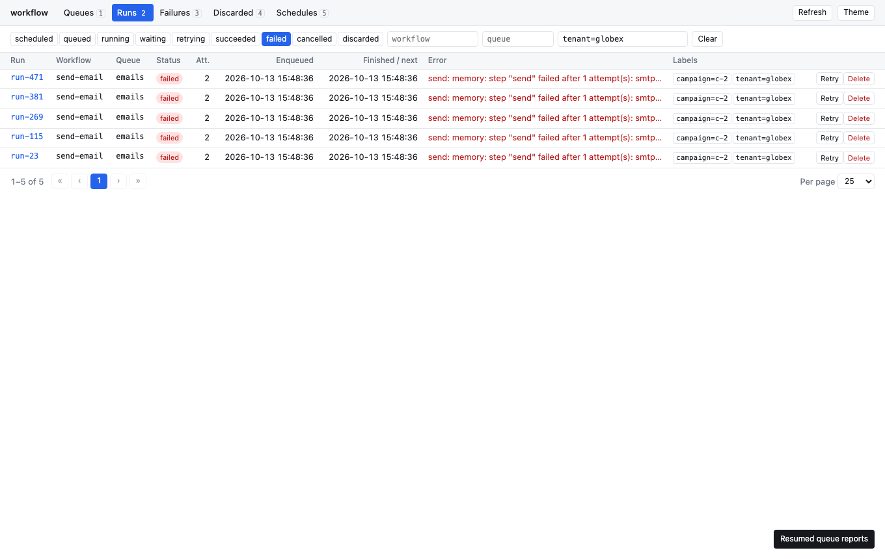

## Before you start

- The admin handler mounted in your app ([Admin JSON API](http-api.md)).
- A login that sets a session cookie. A browser that opens a page sends its cookies but no `Authorization` header, so the UI only opens when your `Identify` accepts the session cookie.
- The example is [`examples/admin-ui`](../../examples/admin-ui). Run it with `go run ./admin-ui` from `examples/`; with `ADMIN_UI_ADDR=127.0.0.1:8090` it keeps serving so you can click through it.

## Step 1: accept the session cookie in Identify

`Identify` is the same function the JSON API uses; reading the cookie is the only change a UI needs. The UI page itself is the action `admin.ActionUI` (`ui.read`), which is read-only, so a role allowed every read-only action can open it:

<!-- snippet: examples/admin-ui/main.go#auth -->
```go
// user is the app's own principal type.
type user struct {
	Name string
	Role string // "admin" may do anything, "viewer" may only read
}

// sessions stands in for the app's session store, keyed by cookie value.
var sessions = map[string]user{"s-ann": {"ann", "admin"}, "s-vic": {"vic", "viewer"}}

var auth = admin.Auth[user]{
	// The browser opening the UI sends the app's session cookie, not an
	// Authorization header, so Identify reads the cookie.
	Identify: func(r *http.Request) (user, error) {
		ck, err := r.Cookie("session")
		if err != nil {
			return user{}, errors.New("no session")
		}
		u, ok := sessions[ck.Value]
		if !ok {
			return user{}, errors.New("unknown session")
		}
		return u, nil
	},
	// ui.read (admin.ActionUI) is read-only, so a viewer can open the UI;
	// every button the UI shows is a JSON request authorized on its own.
	Authorize: func(_ context.Context, req admin.Request[user]) error {
		if req.Who.Role == "admin" || req.Action.ReadOnly() {
			return nil
		}
		return fmt.Errorf("%s may not %s", req.Who.Name, req.Action)
	},
}
```

An `Authorize` that allow-lists actions by name must include `ui.read`, or the page is refused with 403 while the API still works.

## Step 2: mount the handler

<!-- snippet: examples/admin-ui/main.go#mount -->
```go
mux := http.NewServeMux()
mux.Handle("/admin/", http.StripPrefix("/admin", admin.NewHandler(admin.New(c), auth)))
// Open /admin/ in a browser: it redirects to /admin/ui/.
```

`GET /admin/` and `GET /admin/ui` redirect to `ui/`. The redirect is relative, so it keeps whatever prefix you mount the handler under. The page, its style sheet and its script are served at `ui/`, `ui/app.css` and `ui/app.js`.

```text
anonymous GET /admin/ui/: 401
viewer GET /admin/: 302 to ui/
viewer GET /admin/ui/: 200 text/html; charset=utf-8, page true
```

## What it is safe against

The UI adds no new way in. Every file is served only after `Identify` and `Authorize`, like every API route, so an anonymous caller cannot even learn that the UI exists. Every button is a request to the JSON API, authorized on its own action, so a viewer sees every screen and is refused every write:

```text
viewer pauses the schedule: 403
admin pauses the schedule: 200
```

Writes keep the API's rule that the body is `application/json`, which a cross-site form cannot send. The pages carry a strict Content-Security-Policy: only the UI's own files may load, requests go only to the same origin, inline script and style are not allowed, and no site may put the UI in a frame. They also carry `X-Frame-Options: DENY`, `X-Content-Type-Options: nosniff`, `Referrer-Policy: no-referrer` and `Cache-Control: no-store`:

```text
CSP: default-src 'none'; script-src 'self'; style-src 'self'; connect-src 'self'; img-src 'self' data:; base-uri 'none'; form-action 'none'; frame-ancestors 'none'
X-Frame-Options: DENY
```

Payloads are shown on a run's page only when the handler is built with `admin.WithPayloads()`, as in the API.

## The screens

| Screen | What it shows | Actions |
|---|---|---|
| Queues | Each queue's depth, oldest wait and oldest enqueue time; on a driver that scales workers, its workers and running attempts; the active pauses | Pause and resume a queue, a workflow by name, or everything |
| Runs | Runs filtered by status (`retrying` and `discarded` included), workflow, queue, tenant and labels, newest first, with "1–50 of N", numbered pages and a page size of 25, 50, 100 or 200 | Cancel an unfinished run, delete a finished one; with a status filter, cancel all matching (unfinished statuses) or delete all matching (finished statuses), each after a preview |
| Failures, Discarded | Failed runs, and the runs a step dropped with `Discard`, kept apart | Retry from the failed step, delete; retry all matching (Failures) and delete all matching, each after a preview |
| Run | IDs, status, attempts, the next attempt of a retrying run, times with queue wait and duration, the failed step, labels, the error (of the failed attempt, while retrying), every failed attempt with its error (a stack per attempt with `WithStacks`), each attempt's captured output when the `Admin` has `WithOutputs`, a link to the schedule that started it, the tenant, the due time of a delayed run, a progress bar with the latest message, the nodes that ran its attempts (and the node of each failed attempt), whether it has a result (shown with `WithPayloads`), and the payload with `WithPayloads` | Retry, cancel, delete; force complete (unfinished or failed) and force fail with a reason (unfinished), each asking for a second click; reschedule a delayed run that has not started; cancel one step of a running run by name |
| Schedules | Cron, zone, tenant, next fire, last fire with its run and status, a mark when the schedule skips overlapping fires, windows, labels and whether each is paused | Run now, pause and resume a schedule or its workflow |
| Schedule | One schedule: cron, zone, tenant (a link to that tenant's runs), overlap policy, next and last fire, last run, windows, labels, and its recent runs (runs started by Run now are marked manual) | Run now, pause, resume |
| Charts | Run ends over the last 1, 6 or 24 hours, stacked by status (succeeded, failed, cancelled, discarded), optionally for one workflow; totals and the failed share; the value under the pointer; a table of the non-empty steps. Shown when the `Admin` has `WithMetrics` | None |
| System | The health report (live, ready and each check) and the online nodes with their mode, queues, workers, running attempts, start and last report | None |

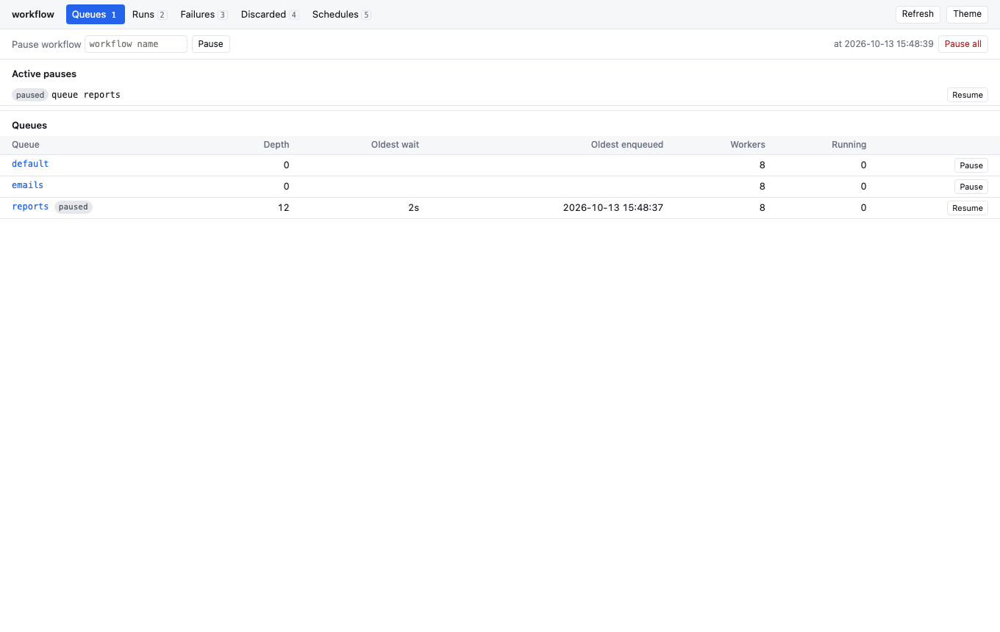

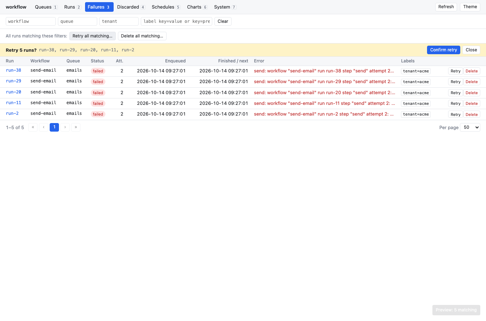

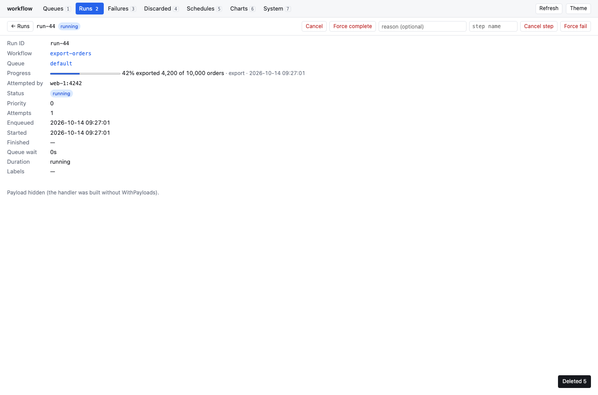

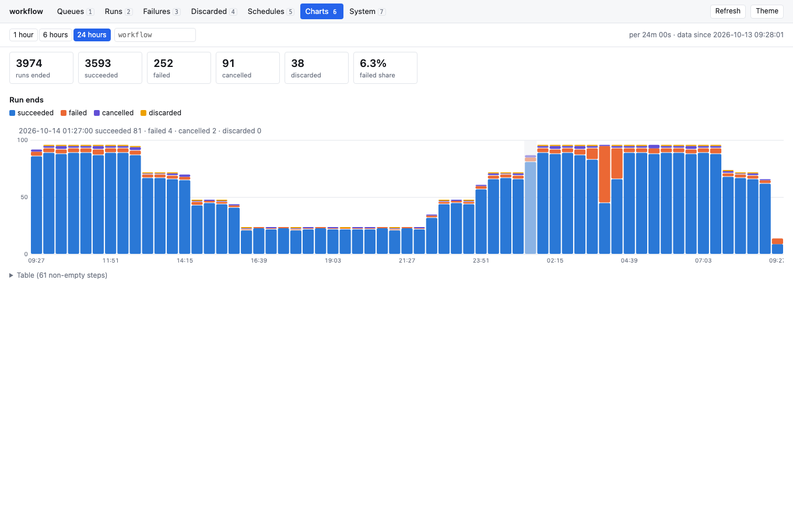

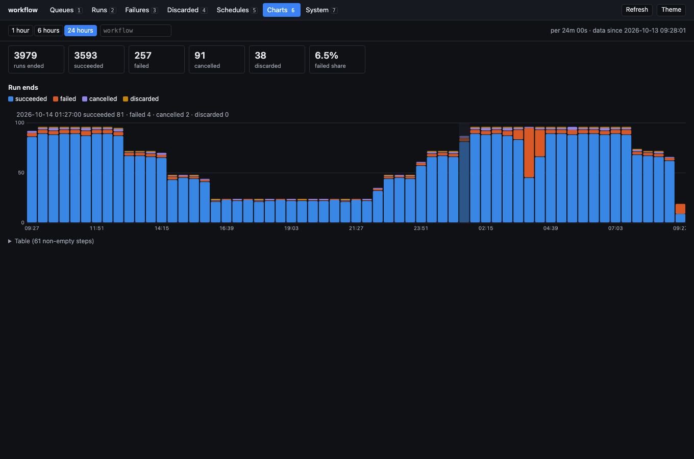

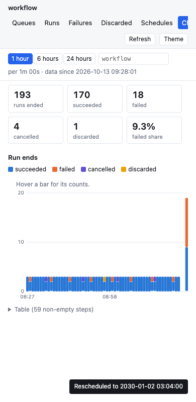

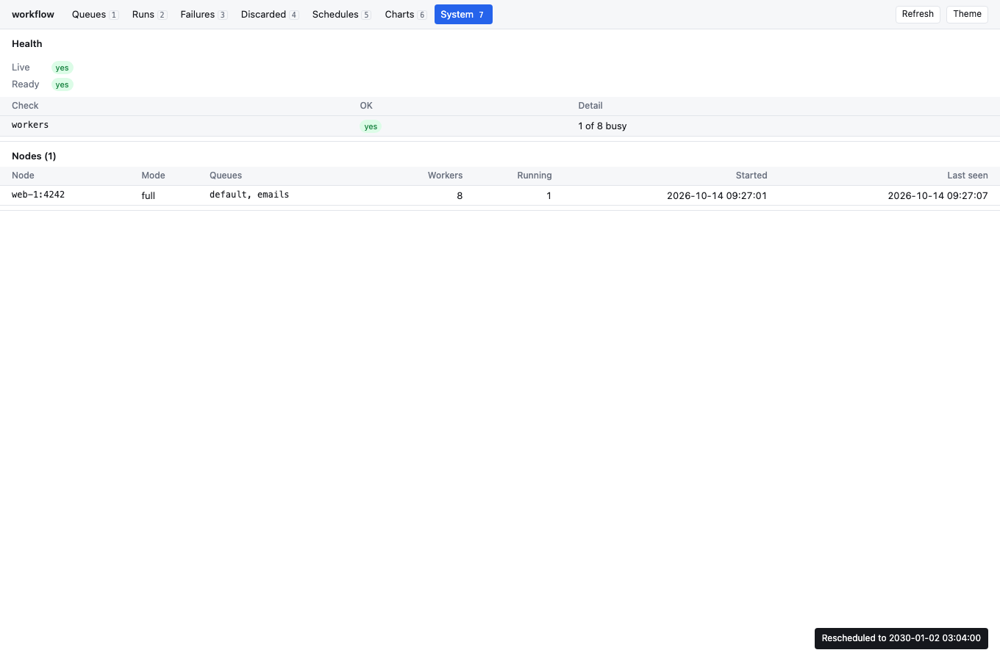

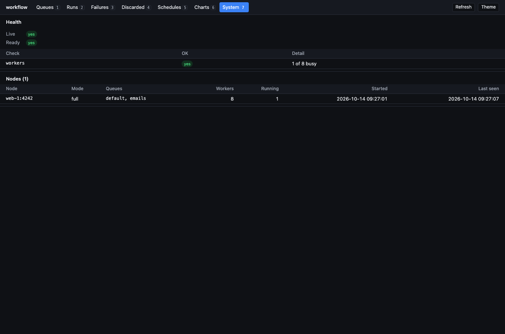

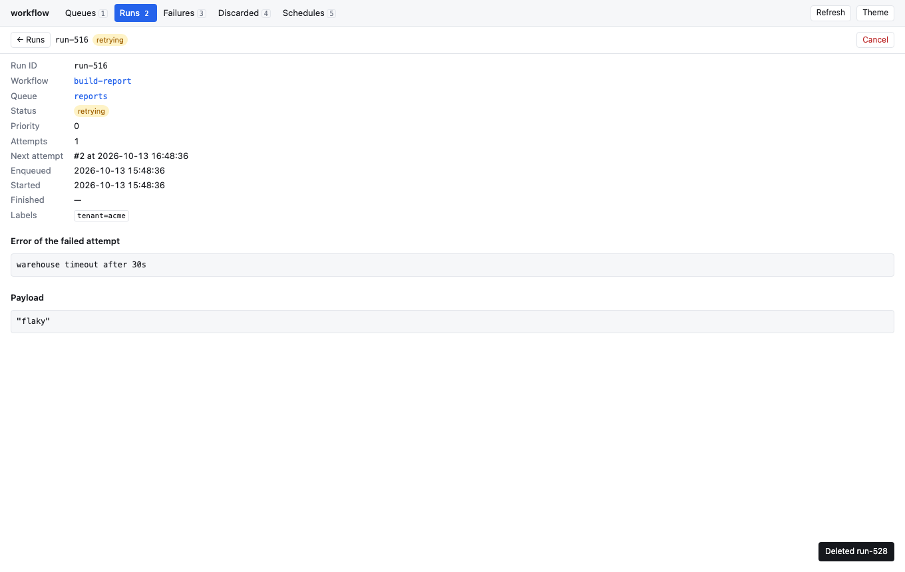

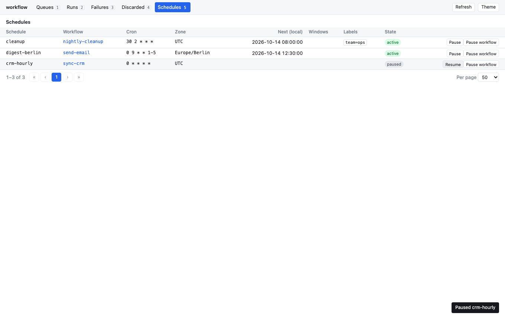

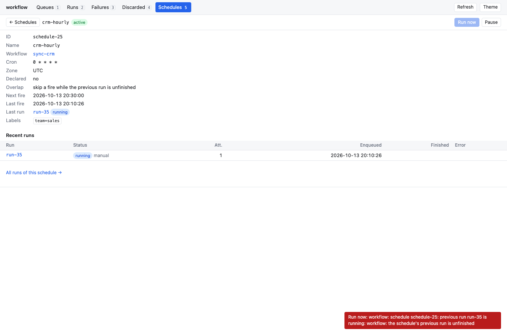

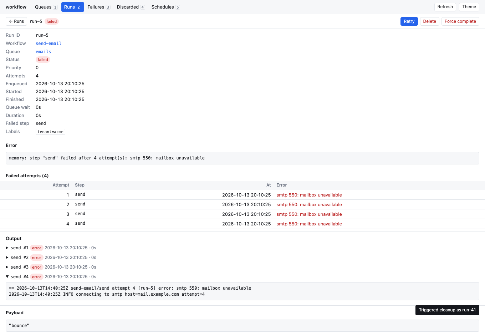

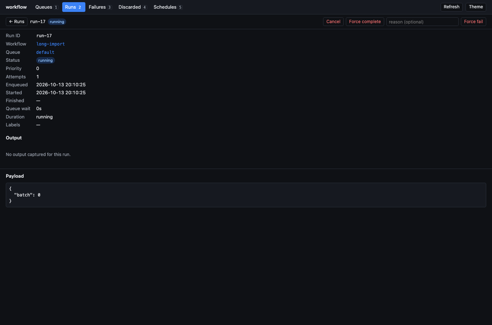

The label box takes space-separated `key=value` pairs that must all match, and `key=prefix*` for a value that starts with a prefix (`key=*` for "has the key"), the API's `label` filter. A prefix needs a driver with `CapLabelPrefix` ([Search by label](../jobs/manage-runs.md#search-by-label)). The page numbers come from the API's `count=1`, which counts within the handler's max scan:

<!-- snippet: examples/admin-ui/main.go#count -->
```go
// What the runs screen asks for: a label prefix and a total for the pages.
_, body, err = call("GET", "/admin/runs?label=tenant=acme*&count=1&limit=50", "s-vic")
```

```text
viewer runs tenant=acme*: 2 runs, total 2
```

Buttons for an operation the driver does not support are hidden: the UI reads the API's `capabilities` route, which answers for the client underneath a wrapper too. Every "all matching" button first asks the server for a dry run with the current filters and shows how many runs it would touch and the first few IDs; only the confirming click acts. A call that hits the server's bulk bound says so, and the same button does the next batch. The charts are drawn as inline SVG under the page's strict content security policy, in colours checked for colour-blind readers in light and dark. Keys: `1` to `7` switch screens, `/` focuses the filter, `←` and `→` change page, `Esc` clears the filters, `r` refreshes and `t` switches between light and dark. Without a choice it follows the system's setting.

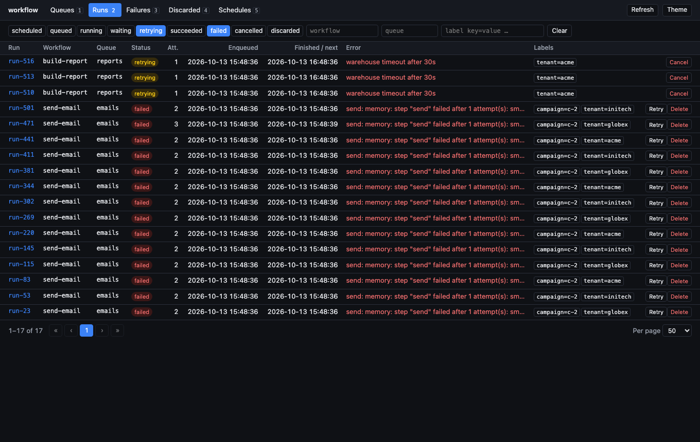

## Pitfalls

- **A bearer-token-only `Identify` locks the UI out.** The API works from scripts, but every page load is answered 401. Accept the session cookie as well.
- **Set the cookie `SameSite=Lax` or `Strict` and `HttpOnly`.** The JSON-only rule stops cross-site form posts; the cookie flags stop the rest.
- **Scope by tenant in `Authorize`, not in the UI.** The UI shows what the API returns. A tenant admin who may only see their own runs needs an `Authorize` that checks `Resource.Query` labels, as for the API ([Admin JSON API › Pitfalls](http-api.md#pitfalls)).
- **Large deployments see "of N+" totals.** The count reads at most the handler's max scan of runs (`WithMaxScan`); past it the total is a lower bound and the last pages are not numbered.
- **Stacks are off by default.** A stack trace names files and functions of your code; build the handler with `admin.WithStacks()` only where the people who open the UI may see that.
- **Run now on a skipping schedule shows an error, not a run.** The overlap policy applies to a manual trigger as it does to a tick, so the button answers 409 while the last run is unfinished.
- **An exact label value that ends in `*` cannot be searched**, since the trailing `*` means a prefix.
- **The charts need a metrics source.** Without `admin.WithMetrics` the Charts screen says none is wired; `admin.MemoryMetrics` starts empty at every restart ([Admin operations › Run-end history for charts](operations.md#run-end-history-for-charts)).
- **A bulk action is several requests.** It acts on at most the handler's bulk bound (`WithMaxBulk`, 1,000) per click, and runs that changed since the preview are skipped and counted.
- **The System screen is not a probe.** It reads the same report as `workflow.CheckHealth` behind the admin login; probes use their own route ([Nodes and health](../operations/nodes.md#health-and-readiness-probes)).

## Related

- [Admin JSON API](http-api.md): the routes the UI calls and the `Auth` hooks.
- [Admin operations](operations.md): the same operations from Go.
- [Queue alerts](alerts.md): be told about a backlog instead of watching for it.
